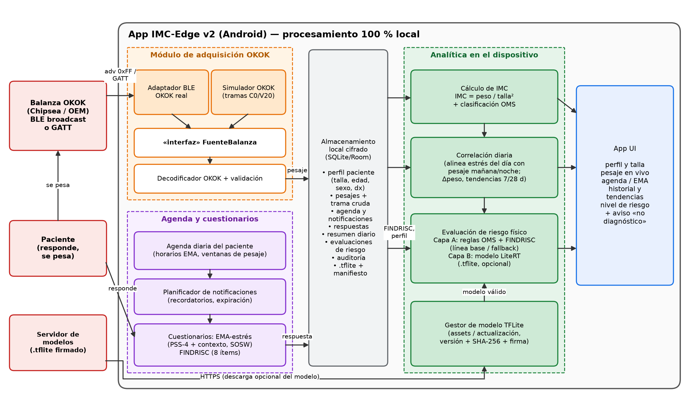
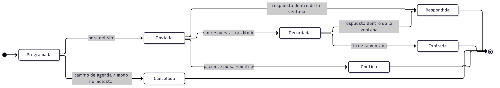
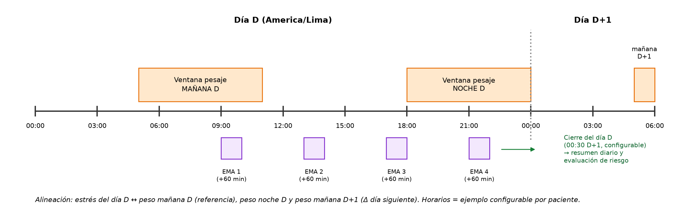
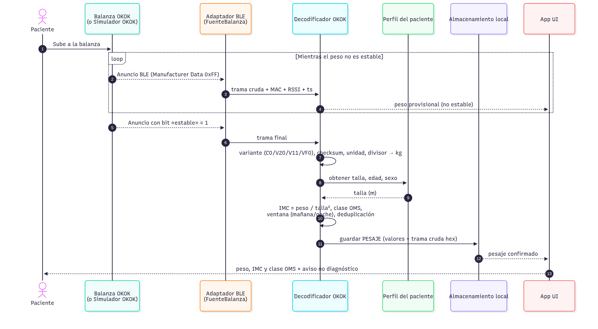
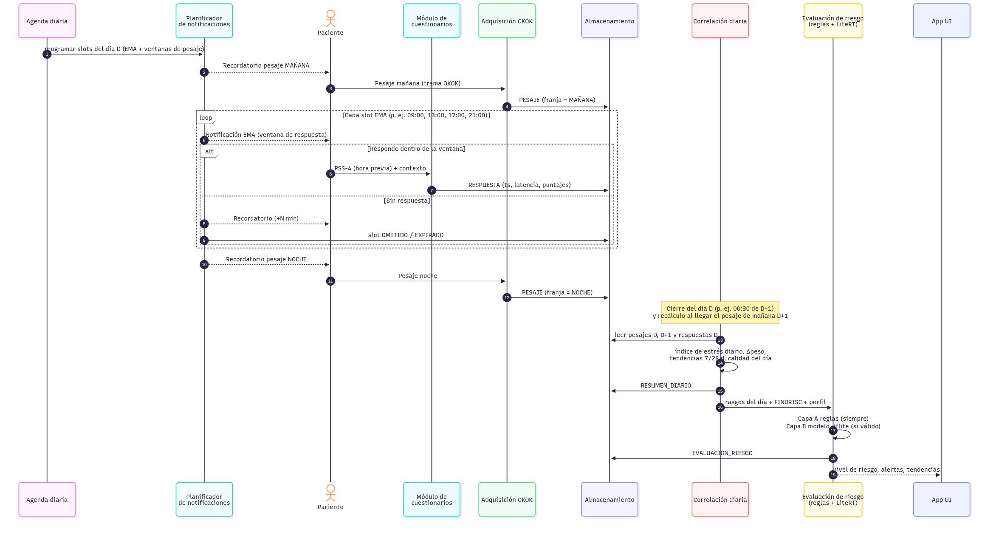
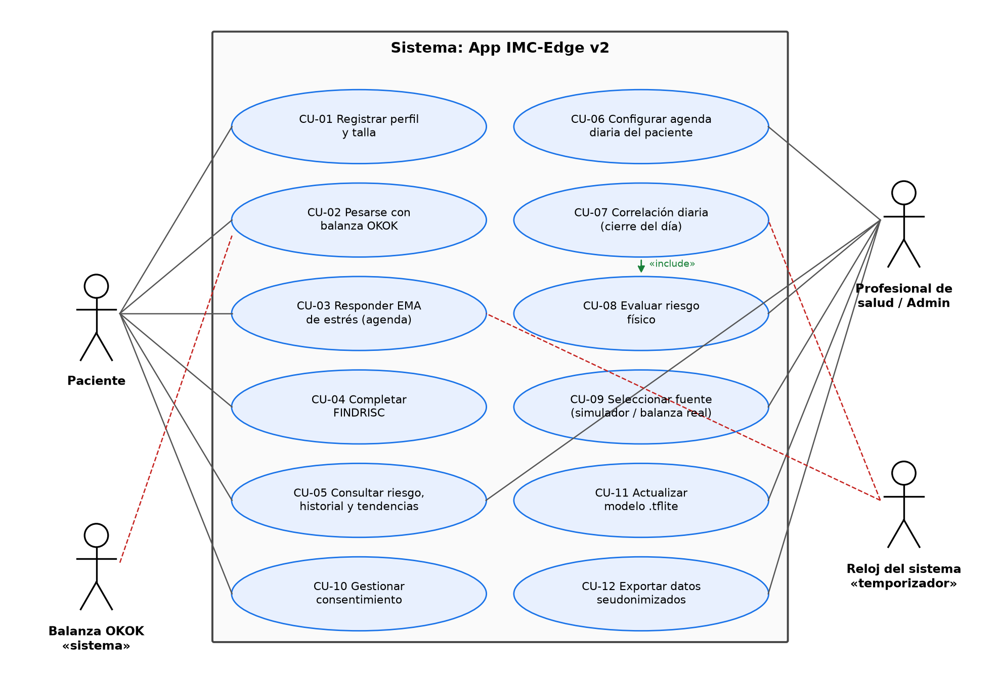
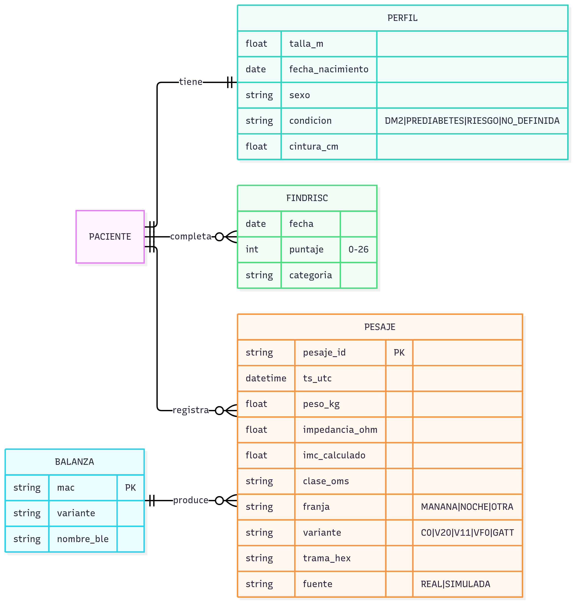
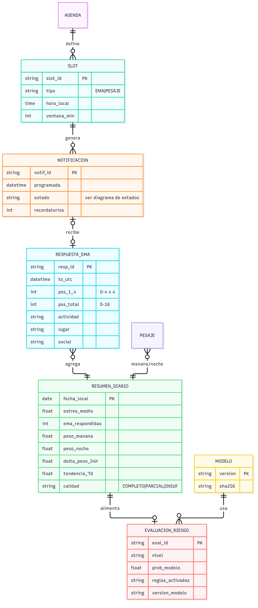
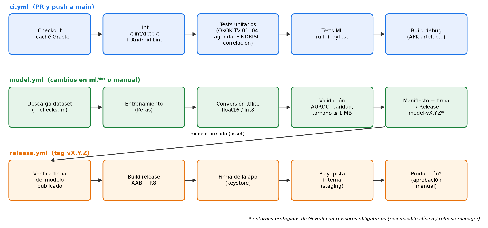

# Especificación de requisitos de software (SRS) — versión 2

**App IMC-Edge: balanza BLE con protocolo OKOK, IMC con talla conocida, agenda diaria de estrés y evaluación de riesgo físico en pacientes con diabetes o prediabetes**

*Versión Markdown del SRS v2.0 (18 de noviembre de 2026) para su versionado en `docs/srs/`.*

*Inferencia local con TensorFlow Lite (LiteRT) y reglas OMS / FINDRISC como línea base · Cuestionarios EMA de estrés tomados del estudio SOSW (IEEE IoT Journal, 2024)*

Conforme a IEEE Std 830-1998 e ISO/IEC/IEEE 29148:2018

| **Documento** | SRS-OKOK-DM-002 |
|---|---|
| **Versión** | 2.0 (borrador para revisión) — reemplaza a SRS-IMC-TFLITE-001 v1.0 |
| **Fecha** | 18 de noviembre de 2026 |
| **Idioma** | Español (Perú) |
| **Estado** | En revisión — contiene ítems «Por definir» |
| **Naturaleza** | Herramienta de apoyo; no es un dispositivo de diagnóstico médico |

**Control de versiones**

| **Versión** | **Fecha** | **Autor** | **Descripción del cambio** |
|---|---|---|---|
| 1.0 | 17/11/2026 | Equipo de análisis | SRS basado en el modelo de estrés SOSW (HR/IBI, smartwatch) con TFLite. |
| 2.0 | 18/11/2026 | Equipo de análisis | Se descarta todo lo derivado del modelo de estrés SOSW (características HR/IBI, LR/MLP de estrés, capa de contexto, métricas F1). Nueva fuente: balanzas BLE con protocolo OKOK; IMC con talla del perfil; evaluación de riesgo físico en diabetes/prediabetes (OMS, FINDRISC, modelo LiteRT); módulo de cuestionarios con los cuestionarios EMA del paper; agenda diaria de estrés y correlación diaria con los pesajes de mañana/noche; sección 10 de repositorio (github.com/CravApp/Gooluco), CI/CD y despliegue. |

**Aprobaciones**

| **Rol**                                    | **Nombre**  | **Firma** | **Fecha** |
|---|---|---|---|
| Product Owner / Cliente                    | Por definir |           |           |
| Médico endocrinólogo / responsable clínico | Por definir |           |           |
| Arquitecto de software                     | Por definir |           |           |
| Responsable de datos / ML                  | Por definir |           |           |
| Responsable de privacidad                  | Por definir |           |           |

## Índice

- [1. Introducción](#1-introducción)
  - [1.1 Propósito](#11-propósito)
  - [1.2 Cambios respecto a la versión 1.0](#12-cambios-respecto-a-la-versión-10)
  - [1.3 Alcance](#13-alcance)
  - [1.4 Definiciones y acrónimos](#14-definiciones-y-acrónimos)
  - [1.5 Referencias](#15-referencias)
- [2. Descripción general](#2-descripción-general)
  - [2.1 Perspectiva del producto](#21-perspectiva-del-producto)
  - [2.2 Protocolo OKOK: lo confirmado y lo pendiente](#22-protocolo-okok-lo-confirmado-y-lo-pendiente)
  - [2.3 Cuestionarios tomados del paper SOSW](#23-cuestionarios-tomados-del-paper-sosw)
  - [2.4 Rol de los cuestionarios en la evaluación de riesgo combinada](#24-rol-de-los-cuestionarios-en-la-evaluación-de-riesgo-combinada)
  - [2.5 Funciones del producto](#25-funciones-del-producto)
  - [2.6 Usuarios](#26-usuarios)
  - [2.7 Restricciones](#27-restricciones)
  - [2.8 Supuestos y dependencias](#28-supuestos-y-dependencias)
- [3. Decisión técnica: TensorFlow Lite (LiteRT) vs. TinyML / TFLite Micro](#3-decisión-técnica-tensorflow-lite-litert-vs-tinyml--tflite-micro)
- [4. Requisitos funcionales](#4-requisitos-funcionales)
  - [4.1 Perfil del paciente](#41-perfil-del-paciente)
  - [4.2 Adquisición OKOK (balanza real y simulador)](#42-adquisición-okok-balanza-real-y-simulador)
  - [4.3 IMC con talla conocida](#43-imc-con-talla-conocida)
  - [4.4 Agenda diaria y cuestionarios](#44-agenda-diaria-y-cuestionarios)
  - [4.5 Correlación diaria estrés ↔ peso](#45-correlación-diaria-estrés-↔-peso)
  - [4.6 Evaluación de riesgo físico](#46-evaluación-de-riesgo-físico)
  - [4.7 Gestión del modelo TFLite](#47-gestión-del-modelo-tflite)
  - [4.8 Privacidad y datos](#48-privacidad-y-datos)
  - [4.9 Modelo de riesgo LiteRT (Capa B)](#49-modelo-de-riesgo-litert-capa-b)
- [5. Requisitos no funcionales](#5-requisitos-no-funcionales)
- [6. Requisitos de interfaces externas](#6-requisitos-de-interfaces-externas)
  - [6.1 Interfaces de usuario](#61-interfaces-de-usuario)
  - [6.2 Interfaces de hardware (balanza OKOK)](#62-interfaces-de-hardware-balanza-okok)
  - [6.3 Interfaces de software](#63-interfaces-de-software)
  - [6.4 Interfaces de comunicaciones](#64-interfaces-de-comunicaciones)
- [7. Modelo de datos y diagramas](#7-modelo-de-datos-y-diagramas)
  - [7.1 Responsabilidades de los módulos](#71-responsabilidades-de-los-módulos)
  - [7.2 Secuencia: balanza → app → IMC](#72-secuencia-balanza-→-app-→-imc)
  - [7.3 Secuencia diaria: agenda → cuestionario → pesaje → correlación → riesgo](#73-secuencia-diaria-agenda-→-cuestionario-→-pesaje-→-correlación-→-riesgo)
  - [7.4 Casos de uso](#74-casos-de-uso)
  - [7.5 Modelo de datos](#75-modelo-de-datos)
- [8. Trazabilidad y criterios de aceptación](#8-trazabilidad-y-criterios-de-aceptación)
  - [8.1 Matriz de trazabilidad requisitos ↔ fuentes](#81-matriz-de-trazabilidad-requisitos-↔-fuentes)
  - [8.2 Criterios de aceptación por requisito funcional](#82-criterios-de-aceptación-por-requisito-funcional)
- [9. Ítems por definir y riesgos](#9-ítems-por-definir-y-riesgos)
  - [9.1 Registro «Por definir»](#91-registro-«por-definir»)
  - [9.2 Riesgos](#92-riesgos)
- [10. Repositorio, CI/CD y despliegue](#10-repositorio-cicd-y-despliegue)
  - [10.1 Estado actual del repositorio](#101-estado-actual-del-repositorio)
  - [10.2 Stack propuesto](#102-stack-propuesto)
  - [10.3 Estructura de carpetas propuesta](#103-estructura-de-carpetas-propuesta)
  - [10.4 Pipeline de GitHub Actions](#104-pipeline-de-github-actions)
  - [10.5 Entornos y secretos](#105-entornos-y-secretos)
  - [10.6 Requisitos de despliegue](#106-requisitos-de-despliegue)
- [Anexo A. YAML de ejemplo de los workflows (PROPUESTA)](#anexo-a-yaml-de-ejemplo-de-los-workflows-propuesta)
  - [A.1 .github/workflows/ci.yml](#a1-githubworkflowsciyml)
  - [A.2 .github/workflows/model.yml](#a2-githubworkflowsmodelyml)
  - [A.3 .github/workflows/release.yml](#a3-githubworkflowsreleaseyml)

# 1. Introducción

## 1.1 Propósito

Este documento especifica los requisitos de la versión 2 de la App IMC-Edge, una aplicación móvil que: (a) **adquiere el peso** desde balanzas de baño Bluetooth Low Energy (BLE) que usan el **protocolo OKOK** (fabricante de chips Chipsea y marcas OEM que funcionan con la app «OKOK International»), ya sea de una balanza real o de un **simulador** que emite tramas idénticas; (b) **calcula el IMC** con la **talla conocida** del perfil del paciente y lo clasifica según la OMS; (c) aplica **cuestionarios**: los cuestionarios breves de estrés tipo EMA del estudio SOSW, programados por una **agenda diaria** del paciente, y el cuestionario FINDRISC; (d) **correlaciona diariamente** el estrés reportado con los pesajes de la mañana y de la noche; y (e) **evalúa el riesgo físico** de pacientes con diabetes, prediabetes o tendencia a diabetes mediante reglas reconocidas (OMS, FINDRISC) y un modelo ligero ejecutado localmente con **TensorFlow Lite (LiteRT)**.

> **Aviso clínico obligatorio.** La App IMC-Edge es una herramienta de **apoyo y autocuidado**. **No diagnostica** diabetes ni ninguna otra enfermedad, no reemplaza la evaluación médica y no debe usarse para decidir tratamientos. El diagnóstico de diabetes y prediabetes requiere pruebas de laboratorio (HbA1c, glucosa en ayunas o PTOG) según criterios de la ADA [R15]. La correlación entre estrés y peso es **exploratoria**.

## 1.2 Cambios respecto a la versión 1.0

| **Se descarta (v1.0)** | **Se conserva / incorpora (v2.0)** |
|---|---|
| Modelo de estrés SOSW: 20 características HR/IBI, filtros PPG, HMM de holgura, regresión logística/MLP de estrés, capa contextual, métricas F1 0,835/0,712. | Estructura IEEE 830 / ISO 29148, contrato de modelo, recomendación LiteRT vs. TFLite Micro, gestor de modelo con firma y versión, privacidad y seguridad. |
| Smartwatch Galaxy Watch 5 como dispositivo de datos. | Balanza BLE con protocolo OKOK como «dispositivo IMC»; módulo de adquisición con dos modos (simulador / balanza real) detrás de una interfaz. |
| Trazabilidad contra las secciones técnicas del paper. | Trazabilidad contra: protocolo OKOK (fuentes abiertas), OMS, FINDRISC, ADA y **solo los cuestionarios** del paper SOSW. |
| — | Nuevos: perfil con talla, cálculo/contraste de IMC, cuestionario FINDRISC, agenda diaria de EMA de estrés, correlación diaria estrés↔peso, evaluación de riesgo en dos capas. |

## 1.3 Alcance

- **Incluido:** perfil del paciente (talla, edad, sexo, condición), adquisición OKOK por BLE (anuncios y, opcionalmente, GATT), simulador OKOK, cálculo de IMC, agenda y notificaciones de cuestionarios, cuestionario EMA de estrés, FINDRISC, correlación diaria, evaluación de riesgo (reglas + LiteRT), historial, exportación seudonimizada, consentimiento.

- **Excluido:** diagnóstico, prescripción, medición de glucosa, integración con historia clínica electrónica (solo exportación), firmware de la balanza, entrenamiento del modelo (se hace fuera de la app), cálculo de composición corporal por BIA para decisiones clínicas.

- **Usuarios objetivo:** adultos (≥ 18 años) con diabetes tipo 2, prediabetes o factores de riesgo; profesionales de salud que los acompañan. Gestantes y menores de 18 años: fuera de alcance (la clasificación OMS del IMC de adulto no aplica).

## 1.4 Definiciones y acrónimos

| **Término** | **Definición** |
|---|---|
| **IMC** | Índice de masa corporal = peso (kg) / talla² (m²), kg/m² [R11]. En v2 «IMC» significa siempre índice de masa corporal (se resuelve la ambigüedad de v1.0). |
| **Protocolo OKOK** | Familia de formatos BLE de balanzas con chip Chipsea compatibles con la app «OKOK International». No es un estándar público: se conoce por ingeniería inversa documentada en proyectos abiertos [R3]–[R10]. |
| **Anuncio BLE / Manufacturer Specific Data** | Paquete de difusión BLE (AD type 0xFF) que contiene un Company ID de 2 bytes (little-endian) y datos del fabricante. Las balanzas OKOK envían el peso sin necesidad de conexión. |
| **GATT** | Perfil de atributos BLE para comunicación con conexión (servicios y características). |
| **Variantes OKOK** | C0, V20, V11, VF0 (anuncios) y «Chipsea-BLE» (GATT), según [R3][R4][R6]. |
| **Impedancia** | Resistencia bioeléctrica (Ω) medida por algunas balanzas; base del análisis de composición corporal (BIA). |
| **EMA** | Ecological Momentary Assessment: cuestionario breve respondido en el momento, en horarios programados [R16]. |
| **PSS-4** | Escala de Estrés Percibido de 4 ítems (Cohen et al.) [R17]; usada en SOSW sobre la hora previa [R16]. |
| **FINDRISC** | Finnish Diabetes Risk Score: cuestionario de 8 ítems (0–26 puntos) que estima el riesgo a 10 años de diabetes tipo 2 [R13]; evaluado en población peruana [R14]. |
| **Agenda diaria** | Configuración por paciente de horarios de cuestionarios y ventanas de pesaje. |
| **Slot** | Evento programado de la agenda (EMA o recordatorio de pesaje) con su ventana de respuesta. |
| **Franja de pesaje** | MAÑANA, NOCHE u OTRA, según la hora local del pesaje estable. |
| **LiteRT / TFLite** | Runtime de Google para modelos .tflite en móviles [R24]. TFLite Micro: variante para microcontroladores [R25]. |
| **Capa A / Capa B** | Capa A: reglas determinísticas (OMS, FINDRISC). Capa B: modelo de riesgo LiteRT. |

## 1.5 Referencias

[R1] IEEE Std 830-1998, IEEE Recommended Practice for Software Requirements Specifications.

[R2] ISO/IEC/IEEE 29148:2018, Systems and software engineering — Life cycle processes — Requirements engineering.

[R3] openScale — OkOkHandler.kt (decodificador de anuncios OKOK V20, V11, VF0 y C0), commit 2f5eeb7 (15/11/2026): https://github.com/oliexdev/openScale/blob/master/android_app/app/src/main/java/com/health/openscale/core/bluetooth/scales/OkOkHandler.kt

[R4] openScale — ChipseaBleHandler.kt y ChipseaBleLib.kt (variante GATT «Chipsea-BLE», servicio 0xFFF0): https://github.com/oliexdev/openScale/tree/master/android_app/app/src/main/java/com/health/openscale/core/bluetooth

[R5] openScale Wiki — Supported scales in openScale: https://github.com/oliexdev/openScale/wiki/Supported-scales-in-openScale

[R6] rrooggiieerr, okokscale.py — librería Python para anuncios BLE de balanzas OKOK (PyPI «okokscale»): https://github.com/rrooggiieerr/okokscale.py · https://pypi.org/project/okokscale/

[R7] Home Assistant — integración «OKOK Scale» (peso, impedancia, batería): https://www.home-assistant.io/integrations/okok_scale/

[R8] 100nandoo, okok-bia-formulas — ingeniería inversa del formato C0 y fórmulas BIA de la app OKOK: https://github.com/100nandoo/okok-bia-formulas

[R9] openScale issue #950 «Another OKOK scale» (capturas hex de tramas C0): https://github.com/oliexdev/openScale/issues/950

[R10] openScale issue #1177 «Support for Yoda0 (OKOK)» (capturas hex, contador tras 0xC0): https://github.com/oliexdev/openScale/issues/1177

[R11] OMS, «Obesity and overweight» (nota descriptiva): IMC ≥ 25 sobrepeso, ≥ 30 obesidad en adultos: https://www.who.int/news-room/fact-sheets/detail/obesity-and-overweight

[R12] WHO Technical Report Series 894, «Obesity: preventing and managing the global epidemic», Ginebra, 2000 (clasificación 18,5 / 25 / 30 / 35 / 40 kg/m²).

[R13] J. Lindström y J. Tuomilehto, «The Diabetes Risk Score: a practical tool to predict type 2 diabetes risk», Diabetes Care, 26(3):725–731, 2003. doi:10.2337/diacare.26.3.725

[R14] A. Bernabe-Ortiz et al., «Diagnostic accuracy of the Finnish Diabetes Risk Score (FINDRISC) for undiagnosed T2DM in Peruvian population», Primary Care Diabetes, 12(6):517–525, 2018: https://pmc.ncbi.nlm.nih.gov/articles/PMC6249987/

[R15] American Diabetes Association, «2. Diagnosis and Classification of Diabetes: Standards of Care in Diabetes—2026», Diabetes Care, 49(Suppl. 1):S27, 2026.

[R16] K. Toshnazarov et al., «SOSW: Stress Sensing With Off-the-Shelf Smartwatches in the Wild», IEEE Internet of Things Journal, 11(12):21527–21543, 2024. doi:10.1109/JIOT.2024.3375299 (solo se usan sus cuestionarios EMA: §V-A, §V-E, Tabla III; y la regla de etiquetado §IV-B).

[R17] S. Cohen, T. Kamarck y R. Mermelstein, «A global measure of perceived stress», Journal of Health and Social Behavior, 24(4):385–396, 1983 (PSS, incluye la versión de 4 ítems).

[R18] E. Remor, «Psychometric properties of a European Spanish version of the Perceived Stress Scale (PSS)», The Spanish Journal of Psychology, 9(1):86–93, 2006.

[R19] W. Choi et al., «Multi-stage receptivity model for mobile just-in-time health intervention», Proc. ACM IMWUT, 3(2), 2019 (método de contexto EMA citado por [R16] como [61]).

[R20] C. Hackett y A. Steptoe, «Type 2 diabetes mellitus and psychological stress — a modifiable risk factor», Nature Reviews Endocrinology, 13:547–560, 2017: https://www.nature.com/articles/nrendo.2017.64

[R21] CDC Diabetes Health Indicators (BRFSS 2015), UCI Machine Learning Repository, id 891, 253 680 registros: https://archive.ics.uci.edu/dataset/891/cdc+diabetes+health+indicators · versión Kaggle: https://www.kaggle.com/datasets/alexteboul/diabetes-health-indicators-dataset

[R22] Pima Indians Diabetes Database (NIDDK; 768 mujeres ≥ 21 años): https://www.kaggle.com/datasets/uciml/pima-indians-diabetes-database

[R23] CDC/NCHS, National Health and Nutrition Examination Survey (NHANES): https://wwwn.cdc.gov/nchs/nhanes/

[R24] Google AI Edge, LiteRT (antes TensorFlow Lite) y cuantización post-entrenamiento: https://ai.google.dev/edge/litert

[R25] TensorFlow Lite for Microcontrollers: https://github.com/tensorflow/tflite-micro

[R26] Ley N.° 29733, Ley de Protección de Datos Personales (Perú), y su Reglamento, D.S. N.° 016-2024-JUS.

# 2. Descripción general

## 2.1 Perspectiva del producto

La App IMC-Edge v2 es un sistema independiente que corre en el smartphone del paciente (Android como plataforma principal). La balanza OKOK solo mide y difunde el peso (y en algunos modelos la impedancia); la app añade la talla, el contexto clínico y los cuestionarios, y procesa todo localmente sin enviar datos de salud a la nube.



*Figura 1. Arquitectura por módulos de la App IMC-Edge v2.*

## 2.2 Protocolo OKOK: lo confirmado y lo pendiente

No existe una especificación pública del fabricante. Lo siguiente se confirmó **leyendo el código fuente** de decodificadores abiertos y capturas publicadas: openScale ([R3], [R4], commit del 15/11/2026), okokscale.py ([R6], usado por la integración oficial de Home Assistant [R7]), okok-bia-formulas [R8] y capturas hex en [R9] y [R10]. Todo lo demás queda **Por definir / verificar con captura BLE** de la balanza concreta.

**Tabla 1. Variantes del protocolo OKOK documentadas en fuentes abiertas**

| **Variante** | **Transporte / identificación** | **Campos y codificación (índices sobre los datos tras el Company ID)** | **Fuente** |
|---|---|---|---|
| **C0** | Anuncio BLE. Company ID con byte bajo 0xC0; el byte alto es un contador que cambia entre tramas. Datos de 13 bytes. Nombre: «Chipsea-BLE», «Yoda0/1», «ADV», vacío o el de la marca; la trama lleva la MAC del equipo. | [0–1] peso u16 big-endian; [2–3] impedancia u16 BE ÷ 10 (Ω) (bit 7 del byte 2 = cifrado según [R6]); [4–5] product ID; [6] atributos: bit0 estable, bits1–2 decimales (0→÷10, 1→÷1, 2→÷100), bits3–4 unidad (kg, jin, lb, st:lb); [7–12] MAC. | [R3][R6][R8][R9][R10] |
| **V20** | Anuncio. Company ID 0x20CA. 19 bytes. | [6] bit0 final, bit2 → ÷100 (si no ÷10); [8–9] peso BE; [10–11] impedancia BE ÷ 10; [12] checksum XOR (inicia en 0x20; algunas versiones incluyen el byte 11). | [R3][R6] |
| **V11** | Anuncio. Company ID 0x11CA. 23 bytes. | [3–4] peso BE; [9] propiedades: bits1–2 resolución, bits3–4 unidad; [16] checksum XOR (inicia en 0xCA⊕0x11). Bit «final» en [1] según [R6]. | [R3][R6] |
| **VF0** | Anuncio. Company ID 0xF0FF. | Peso u16 con MSB en [3] y LSB en [2], ÷ 10. Sin estabilidad ni impedancia documentadas. | [R3][R6] |
| **V10 / V26** | Anuncio. Company ID 0x10FF / 0x26C0. | Índices de peso conocidos pero **no implementados** ni validados en [R6]. Por definir. | [R6] |
| **Chipsea-BLE (GATT)** | Conexión GATT. Servicio 0xFFF0; notificaciones en 0xFFF1; escritura en 0xFFF2; tramas con cabecera 0xCA. La app debe enviar al conectar un «user sync» (fecha/hora, id de usuario, sexo, edad, talla en cm, XOR). | Peso + estado bloqueado; con peso estable: % grasa, % agua, % músculo, TMB (kcal), grasa visceral, masa ósea (valores calculados por la balanza). | [R4][R5] |
| **GATT estándar (algunos modelos)** | Body Composition Measurement 0x2A9C, Battery Level 0x2A19 y características propietarias 0xFFF1/0xFFF2/0xFA9C/0xFAA1 vistas en una Tristar WG-2440. | Impedancia y batería por conexión activa. Mapeo exacto por modelo: Por definir. | [R6][R7] |

![Figura 2. Estructura de la trama OKOK C0 con el ejemplo documentado en [R8] (67,05 kg; 600,0 Ω).](img/fig-02-trama-okok-c0.png)

*Figura 2. Estructura de la trama OKOK C0 con el ejemplo documentado en [R8] (67,05 kg; 600,0 Ω).*

> **Hallazgo importante sobre el IMC.** Ninguna de las tramas documentadas (C0, V20, V11, VF0, Chipsea-BLE GATT) **transmite el IMC**. Las balanzas envían peso y, en algunos modelos, impedancia o composición corporal; el IMC que muestra la app OKOK se calcula **en el teléfono** a partir del peso y de la talla del perfil (esto último se infiere de los decodificadores, que piden talla, edad y sexo para calcular la composición; verificar con captura). Por eso la App IMC-Edge **calcula** el IMC con la talla conocida (RF-14) y solo lo **contrasta** con un IMC externo cuando exista (pantalla de la balanza, app OKOK o ingreso manual; RF-15).

**Tabla 2. Vectores de prueba reales tomados de fuentes (se usarán en criterios de aceptación y en el simulador)**

| **ID** | **Datos del fabricante (hex)** | **Resultado esperado** | **Fuente** |
|---|---|---|---|
| **TV-01** | Company ID 0x07C0 · datos 1A 31 17 70 0A 01 25 24 16 51 4B 12 3C | 67,05 kg, estable, kg; impedancia 600,0 Ω | [R8] |
| **TV-02** | Company ID 0x3FC0 · datos 1D CE 13 88 00 00 25 00 00 00 00 00 00 | 76,30 kg (el usuario reportó 76,3 kg); impedancia 500,0 Ω | [R10] |
| **TV-03** | Company ID 0xB1C0 · datos 1F D6 17 70 0A 01 25 5D 02 49 A6 3D E8 | 81,50 kg, estable | [R9] |
| **TV-04** | Company ID 0x08C0 · datos 13 D3 17 70 0A 01 24 5D 02 49 A6 3D E8 | 50,75 kg, **no estable** (bit0 = 0): se descarta como final | [R9] |

## 2.3 Cuestionarios tomados del paper SOSW

Del estudio SOSW [R16] **solo se conservan los cuestionarios**. El paper los aplicó como EMA en el smartphone: 12 notificaciones diarias en intervalos aleatorios de 40–80 min, durante 2 semanas, pidiendo responder sobre la **hora previa** (§V-E). Los cuestionarios (Tabla III del paper) son:

| **Bloque** | **Contenido (según Tabla III de [R16])** | **Respuesta** |
|---|---|---|
| **Estrés percibido (PSS-4) [R17]** | 1) ¿Con qué frecuencia sintió que no podía controlar las cosas importantes? 2) ¿…se sintió seguro de su capacidad para manejar sus problemas? 3) ¿…sintió que las cosas le iban bien? 4) ¿…sintió que las dificultades se acumulaban tanto que no podía superarlas? | Likert de 5 puntos (Nunca … Muy a menudo); ítems 2 y 3 invertidos. |
| **Actividad actual [R19]** | Trabajando/estudiando, durmiendo, descansando/relajándose, viendo videos, en clase/reunión, comiendo/bebiendo, jugando, conversando, preparándose para dormir, llamando/escribiendo mensajes, recién despierto, manejando, otra (13 categorías). | Opción única |
| **Lugar actual** | Casa, trabajo, restaurante, vehículo, otro. | Opción única |
| **Contexto social** | Social / asocial. | Binaria |

**Etiquetado del paper que se reutiliza:** SOSW invierte los ítems 2 y 3, promedia los ítems de estrés y clasifica como «estresado» cuando el puntaje supera la **media personal** del participante (§IV-B). La App IMC-Edge usa esa misma regla para marcar «días de estrés elevado» respecto a la línea base de cada paciente (RF-25).

**Adaptaciones de v2 (no provienen del paper):** horarios **fijos y configurables** por agenda en lugar de aleatorios; menos EMA por día (por defecto 4; configurable de 1 a 12) para reducir carga en pacientes; traducción al español basada en una versión validada (p. ej. Remor [R18]); la validación de la PSS-4 con referencia a la «hora previa» en población peruana está **Por definir**.

## 2.4 Rol de los cuestionarios en la evaluación de riesgo combinada

- **FINDRISC** [R13] es el instrumento principal para personas **sin diagnóstico** de diabetes (prediabetes o tendencia): usa edad, IMC (calculado por la app con peso OKOK y talla), perímetro de cintura, actividad física, consumo de frutas y verduras, antihipertensivos, glucosa alta previa y antecedentes familiares. Se evaluó en Perú con AUROC 0,69 y punto de corte óptimo 11 [R14].

- **EMA de estrés (PSS-4 + contexto)** no forma parte de FINDRISC ni modifica su puntaje validado. Se usa como **factor psicosocial complementario**: el estrés psicológico es un factor de riesgo modificable asociado a la diabetes tipo 2 y a peor control glucémico [R20], y la ADA recomienda atención psicosocial [R15]. Genera alertas y alimenta, como entrada opcional, el modelo de la Capa B.

- **El contexto EMA** (actividad, lugar, social) aporta información de conducta (p. ej. sedentarismo) que se presenta en las tendencias y puede usarse como entrada exploratoria del modelo.

- **Pacientes con diabetes ya diagnosticada:** FINDRISC **no aplica** (estima el riesgo de desarrollarla). Para ellos el «riesgo físico» se basa en la clase de IMC (OMS), el perímetro de cintura, la trayectoria de peso y el patrón de estrés, como apoyo al seguimiento.

## 2.5 Funciones del producto

- **F1 Perfil del paciente:** talla, fecha de nacimiento, sexo, condición (DM2 / prediabetes / riesgo), cintura.

- **F2 Adquisición OKOK:** escaneo BLE, decodificación de variantes, estabilidad, deduplicación, persistencia con trama cruda; simulador OKOK.

- **F3 IMC:** cálculo con talla conocida, clasificación OMS, contraste con IMC externo.

- **F4 Agenda y cuestionarios:** agenda diaria, notificaciones, recordatorios, omisiones, EMA de estrés, FINDRISC.

- **F5 Correlación diaria:** asignación de pesajes a mañana/noche, resumen diario, Δpeso, tendencias, correlación exploratoria.

- **F6 Evaluación de riesgo:** Capa A (reglas OMS/FINDRISC) y Capa B (LiteRT), alertas y derivación al profesional.

- **F7 Datos y privacidad:** consentimiento, cifrado, exportación seudonimizada, eliminación.

## 2.6 Usuarios

| **Perfil** | **Descripción** | **Nivel técnico** |
|---|---|---|
| **Paciente** | Adulto con DM2, prediabetes o tendencia; se pesa, responde cuestionarios y consulta su evolución. Puede ser adulto mayor. | Básico |
| **Profesional de salud / Administrador** | Configura agenda, umbrales clínicos y fuente de datos; revisa reportes exportados. | Intermedio |
| **Equipo de datos / ML** | Entrena, convierte, cuantiza y firma el modelo .tflite. | Experto |
| **Balanza OKOK (sistema)** | Difunde tramas BLE (o es emulada por el simulador). | — |
| **Reloj del sistema (temporizador)** | Dispara slots de agenda y el cierre del día. | — |

## 2.7 Restricciones

- El protocolo OKOK no es público y varía por modelo y firmware; cada balanza comercial debe verificarse con una captura BLE antes de declararse compatible.

- Las tramas en difusión **no identifican al usuario**; si varias personas usan la misma balanza, la asignación del pesaje al paciente requiere confirmación (RF-09).

- Android exige permisos de escaneo BLE (BLUETOOTH_SCAN desde Android 12; ubicación en versiones anteriores) y de notificaciones (POST_NOTIFICATIONS desde Android 13); las alarmas exactas tienen restricciones del sistema operativo.

- La clasificación OMS del IMC de adulto no aplica a menores de 18 años ni a gestantes; el IMC no distingue masa grasa de masa muscular.

- Los valores de composición corporal (BIA) de balanzas comerciales no están validados clínicamente; solo se muestran como información y no entran en la Capa A.

- Cumplimiento de la Ley N.° 29733 y su reglamento: los datos de salud son datos sensibles [R26].

## 2.8 Supuestos y dependencias

- El paciente o el profesional registran una talla medida (cm) en el perfil.

- Se dispone de al menos una balanza OKOK de referencia para capturar y validar tramas (TBD-02).

- El perímetro de cintura se ingresa manualmente (la balanza no lo mide).

- Un profesional de salud valida los umbrales clínicos de alertas (TBD-07) antes del uso con pacientes.

# 3. Decisión técnica: TensorFlow Lite (LiteRT) vs. TinyML / TFLite Micro

Se mantiene la decisión de v1.0 y se refuerza: el modelo de riesgo corre en la **app móvil**, donde se juntan peso, talla y cuestionarios. La balanza OKOK tiene firmware cerrado del fabricante, por lo que **no es posible ejecutar TFLite Micro dentro de ella**.

| **Criterio** | **TensorFlow Lite / LiteRT (app)** | **TFLite Micro (TinyML)** |
|---|---|---|
| **Destino** | Smartphone Android/iOS con sistema operativo. | Microcontrolador sin SO. |
| **Runtime** | Del orden de cientos de KB a ~1 MB según operadores [R24]. | ~16 KB de núcleo en Cortex-M3 [R25]. |
| **Modelo de riesgo previsto** | Regresión logística o MLP pequeño sobre ~15–25 entradas tabulares: decenas de KB o menos (medir, TBD-08). | Igual de pequeño, pero no hay MCU programable disponible. |
| **Carga / actualización** | Desde assets o descarga firmada; reemplazo en caliente. | Compilado en el firmware; requiere reflashear. |
| **Integración** | Gradle/Kotlin; ejemplos oficiales. | C++ embebido; no orientado a apps. |
| **Encaje** | **Recomendado.** | No aplicable (balanza cerrada). |

> **Recomendación:** LiteRT en la app con cuantización **float16** (o int8 si la pérdida de AUROC es ≤ 0,01 frente a float32). Para modelos tabulares tan pequeños el tamaño no es crítico; la prioridad es la **paridad** del preprocesamiento (normalización, codificación de ítems) entre entrenamiento y app, y la **Capa A de reglas** como fallback siempre disponible.

# 4. Requisitos funcionales

Prioridad MoSCoW: **A** = alta (Must), **M** = media (Should), **B** = baja (Could).

## 4.1 Perfil del paciente

| **ID** | **Nombre** | **Descripción** | **Prior.** |
|---|---|---|---|
| **RF-01** | Perfil del paciente | Registrar talla (cm), fecha de nacimiento, sexo, condición (DM2 / prediabetes / riesgo / no definida), perímetro de cintura (cm, opcional) y profesional responsable (opcional). | A |
| **RF-02** | Validación e historial de talla | La talla debe estar entre 100 y 230 cm (configurable); cada cambio guarda fecha y autor. Los IMC calculados conservan la talla usada. | A |

## 4.2 Adquisición OKOK (balanza real y simulador)

| **ID** | **Nombre** | **Descripción** | **Prior.** |
|---|---|---|---|
| **RF-03** | Interfaz FuenteBalanza | El módulo de adquisición expone una interfaz común (escanear, conectar, iniciar, detener, estado, flujo de tramas) implementada por el Adaptador BLE OKOK y por el Simulador OKOK. | A |
| **RF-04** | Escaneo BLE y filtrado | Escanear anuncios BLE en primer plano o durante las ventanas de pesaje y reconocer balanzas OKOK por: Company ID con byte bajo 0xC0, 0x20CA, 0x11CA o 0xF0FF; nombres «Chipsea-BLE», «Yoda0», «Yoda1», «ADV»; o MAC embebida en la trama C0 [R3]. | A |
| **RF-05** | Decodificación de variantes | Decodificar C0, V20, V11 y VF0 según la Tabla 3 (longitud, checksum XOR cuando exista, divisor, unidad y conversión a kg; jin ÷ 2, lb × 0,4536, st:lb). Descartar tramas C0 marcadas como cifradas. V10/V26: registrar como «no soportada». | A |
| **RF-06** | Variante GATT Chipsea-BLE | Opcionalmente conectar por GATT (servicio 0xFFF0, notificación 0xFFF1, escritura 0xFFF2), enviar el «user sync» con talla/edad/sexo y leer peso y, si existen, valores de composición [R4]. | M |
| **RF-07** | Estabilidad del peso | Mostrar el peso provisional en vivo y registrar solo el peso **estable/final** (bit de estabilidad); en variantes sin bit de estabilidad, considerar estable cuando el peso no varía más de 0,1 kg durante 3 s (por definir con captura). | A |
| **RF-08** | Vinculación de balanza | Permitir registrar la balanza del paciente (MAC, variante, nombre) e ignorar otras balanzas cercanas. | A |
| **RF-09** | Asignación al paciente y deduplicación | Asociar el pesaje estable al paciente activo. Si el peso difiere más de un umbral (por defecto 5 kg) de su último peso, pedir confirmación («¿es usted?»). Las tramas repetidas (misma MAC y peso en 60 s) generan un solo pesaje. | A |
| **RF-10** | Persistencia del pesaje | Guardar peso (kg), impedancia (si existe), unidad original, variante, MAC, RSSI, marca de tiempo UTC y hora local, fuente (REAL/SIMULADA) y la **trama cruda en hex** para auditoría. | A |
| **RF-11** | Simulador OKOK | El simulador debe emitir tramas **en el mismo formato byte a byte** que las variantes C0 y V20 (con contador, atributos, checksum y MAC), configurables: peso objetivo, ruido, tiempo hasta estabilizar, unidad, impedancia, cifrado, pérdida de tramas, perfiles de tendencia diaria (subida/bajada) y semilla. | A |
| **RF-12** | Reproducción de capturas | El simulador debe reproducir capturas hex o btsnoop de balanzas reales, incluidos los vectores TV-01 a TV-04. | M |
| **RF-13** | Errores y suspensión de la balanza | Gestionar Bluetooth apagado, permisos denegados, ausencia de tramas (timeout configurable, por defecto 60 s) y suspensión de la balanza; informar al paciente y registrar el error con código. | A |

## 4.3 IMC con talla conocida

| **ID** | **Nombre** | **Descripción** | **Prior.** |
|---|---|---|---|
| **RF-14** | Cálculo de IMC y clase OMS | Calcular IMC = peso / talla² con 1 decimal y clasificar: < 18,5 bajo peso; 18,5–24,9 normal; 25,0–29,9 sobrepeso; 30,0–34,9 obesidad I; 35,0–39,9 obesidad II; ≥ 40 obesidad III [R11][R12]. | A |
| **RF-15** | Contraste con IMC externo | Si existe un IMC externo (pantalla de la balanza, app OKOK o ingreso manual) y difiere del calculado en más de 0,5 kg/m² (configurable), alertar de una posible talla desactualizada en el perfil. | M |

## 4.4 Agenda diaria y cuestionarios

| **ID** | **Nombre** | **Descripción** | **Prior.** |
|---|---|---|---|
| **RF-16** | Agenda diaria configurable | Por paciente: número de EMA por día (1–12, por defecto 4), horarios (p. ej. 09:00, 13:00, 17:00, 21:00), días activos, ventana de respuesta (por defecto 60 min), ventanas de pesaje MAÑANA (por defecto 05:00–11:00) y NOCHE (por defecto 18:00–23:59) y horario de no molestar. | A |
| **RF-17** | Programación de notificaciones | Programar notificaciones locales para cada slot (EMA y recordatorios de pesaje) que se mantengan tras reiniciar el teléfono, cambiar la hora o actualizar la app, usando la zona horaria del paciente (por defecto America/Lima). | A |
| **RF-18** | Ventanas y recordatorios | Cada EMA puede responderse solo dentro de su ventana; si no hay respuesta tras N min (por defecto 20), enviar un recordatorio (máximo configurable, por defecto 1). | A |
| **RF-19** | Omisiones y expiración | Registrar cada slot como RESPONDIDA, OMITIDA (el paciente pulsa «omitir»), EXPIRADA (sin respuesta) o CANCELADA (cambio de agenda), y calcular la adherencia diaria y semanal. | A |
| **RF-20** | Cuestionario EMA de estrés | Presentar PSS-4 referido a la hora previa (4 ítems Likert 0–4, ítems 2 y 3 invertidos) y el contexto del paper (actividad, 13 opciones; lugar, 5; social, binario) [R16]. Tiempo objetivo de respuesta ≤ 60 s. | A |
| **RF-21** | Registro con marca de tiempo | Guardar cada respuesta con: slot y fecha programada, hora de notificación, hora de respuesta (UTC y local), latencia, puntajes por ítem, total PSS-4 (0–16), contexto y versión del cuestionario. | A |
| **RF-22** | Cuestionario FINDRISC | Aplicar los 8 ítems de FINDRISC [R13] al inicio y cada 3 meses (configurable), completando automáticamente edad (perfil) e IMC (último pesaje + talla); cintura manual. Calcular el puntaje 0–26 y la categoría (< 7 bajo; 7–11 ligeramente elevado; 12–14 moderado; 15–20 alto; > 20 muy alto). No aplica a pacientes con DM2 diagnosticada. | A |
| **RF-23** | Cambios de agenda y zona horaria | Ante cambios de agenda o de zona horaria, reprogramar los slots futuros sin alterar los registros pasados. | M |

**Tabla 3. Ejemplo de agenda diaria (valores por defecto, configurables por paciente)**

| **Slot** | **Tipo**      | **Hora local** | **Ventana** | **Recordatorio**       |
|---|---|---|---|---|
| P-M      | Pesaje MAÑANA | 06:30 (aviso)  | 05:00–11:00 | 09:30 si no hay pesaje |
| EMA-1    | EMA de estrés | 09:00          | 60 min      | +20 min                |
| EMA-2    | EMA de estrés | 13:00          | 60 min      | +20 min                |
| EMA-3    | EMA de estrés | 17:00          | 60 min      | +20 min                |
| P-N      | Pesaje NOCHE  | 21:00 (aviso)  | 18:00–23:59 | 22:30 si no hay pesaje |
| EMA-4    | EMA de estrés | 21:00          | 60 min      | +20 min                |



*Figura 3. Estados de una notificación EMA (RF-18, RF-19).*

## 4.5 Correlación diaria estrés ↔ peso

| **ID** | **Nombre** | **Descripción** | **Prior.** |
|---|---|---|---|
| **RF-24** | Asignación de pesajes al día | Asignar cada pesaje estable a la fecha local D y franja MAÑANA, NOCHE u OTRA según las ventanas de la agenda. Si hay varios en una franja: MAÑANA = primero estable; NOCHE = último estable. Un pesaje nocturno entre 00:00 y 01:00 (gracia configurable) se asigna a la NOCHE del día anterior. | A |
| **RF-25** | Resumen diario | Al cierre del día D (por defecto 00:30 de D+1) generar el RESUMEN_DIARIO: EMA respondidas/programadas, estrés medio del día (media de PSS-4 total), día de estrés elevado (media > línea base personal, regla de [R16]), peso mañana y noche, IMC, Δ intradía (noche − mañana) y Δ24h (mañana D+1 − mañana D). | A |
| **RF-26** | Datos faltantes y calidad del día | Sin imputación para indicadores clínicos. Día COMPLETO: ≥ 2 EMA respondidas (configurable) y pesaje de mañana; PARCIAL: solo uno de los dos; INSUFICIENTE: ninguno. Δ24h requiere ambos pesajes de mañana; la línea base de estrés requiere ≥ 7 días válidos (configurable). | A |
| **RF-27** | Tendencias y correlación exploratoria | Calcular la pendiente de peso a 7 días (≥ 4 pesajes de mañana) y a 28 días, y la correlación de Spearman entre estrés diario y Δ24h en ventana móvil de 28 días con ≥ 14 pares válidos; mostrar n y la etiqueta «exploratorio, no diagnóstico». | M |
| **RF-28** | Recálculo por datos tardíos | Si llega un pesaje o respuesta tardía (hasta 48 h), recalcular los resúmenes y las evaluaciones afectados y registrar la versión. | M |



*Figura 4. Reglas de alineación temporal del día D (ejemplo con horarios por defecto).*

## 4.6 Evaluación de riesgo físico

| **ID** | **Nombre** | **Descripción** | **Prior.** |
|---|---|---|---|
| **RF-29** | Riesgo Capa A (reglas) | Calcular siempre: clase OMS de IMC; categoría FINDRISC (si aplica); obesidad abdominal por cintura según los umbrales de FINDRISC (varones ≥ 94 / > 102 cm, mujeres ≥ 80 / > 88 cm); alertas de tendencia de peso y de estrés sostenido con umbrales configurables (TBD-07). Resultado: nivel de riesgo y reglas activadas. | A |
| **RF-30** | Riesgo Capa B (modelo LiteRT) | Si hay un modelo válido, construir el vector de entrada del contrato (edad, sexo, talla, peso, IMC, cintura, ítems FINDRISC, estrés medio 7 d, adherencia EMA, pendiente de peso 7 d…), normalizar con los parámetros del manifiesto, ejecutar la inferencia local y obtener una probabilidad complementaria. | M |
| **RF-31** | Fallback y discrepancias | Si el modelo no está disponible, falla la validación o faltan entradas obligatorias o están fuera de rango, usar solo la Capa A. El nivel mostrado es el de la Capa A; la probabilidad de la Capa B se muestra como «estimación complementaria» y las discrepancias se registran. | A |
| **RF-32** | Presentación del riesgo | Mostrar nivel de riesgo, IMC y clase, tendencia de peso, adherencia EMA, estrés semanal y la fecha del último FINDRISC, con el aviso permanente «apoyo, no diagnóstico». | A |
| **RF-33** | Derivación | Con nivel alto/muy alto, obesidad o alertas sostenidas, recomendar consultar a un profesional de salud y realizar pruebas de laboratorio (HbA1c/glucosa) [R15], sin sugerir tratamiento. | A |

**Tabla 4. Reglas de la Capa A (línea base y fallback)**

| **Regla** | **Entrada** | **Criterio** | **Fuente** |
|---|---|---|---|
| **A1 Clase de IMC** | Peso OKOK + talla | < 18,5 / 18,5–24,9 / 25–29,9 / 30–34,9 / 35–39,9 / ≥ 40 kg/m² | [R11][R12] |
| **A2 FINDRISC (sin DM2)** | 8 ítems | < 7 bajo (~1 de 100 a 10 años); 7–11 ligeramente elevado (~1/25); 12–14 moderado (~1/6); 15–20 alto (~1/3); > 20 muy alto (~1/2). Referencia peruana: corte 11 [R14]. | [R13][R14] |
| **A3 Cintura** | Cintura (cm), sexo | Varones 94–102 / > 102 cm; mujeres 80–88 / > 88 cm (puntos de FINDRISC). | [R13] |
| **A4 Tendencia de peso** | Pesajes de mañana | Ganancia o pérdida > X kg en 7 días o > Y % en 28 días: **Por definir** con el profesional (TBD-07). | Clínico |
| **A5 Estrés sostenido** | Resumen diario | ≥ N días consecutivos de estrés elevado sobre la línea base personal: **Por definir** (TBD-07). Genera alerta psicosocial, no cambia el nivel FINDRISC. | [R15][R16][R20] |
| **A6 Adherencia** | Agenda | Adherencia EMA < 50 % en 7 días → aviso de datos insuficientes (umbral por definir). | Diseño |

## 4.7 Gestión del modelo TFLite

| **ID** | **Nombre** | **Descripción** | **Prior.** |
|---|---|---|---|
| **RF-34** | Carga del modelo desde assets | Cargar el .tflite y su manifiesto empaquetados al iniciar la app. | M |
| **RF-35** | Verificación de modelo | Verificar SHA-256, firma del manifiesto, versión, versión mínima de la app y contrato de tensores antes de usar un modelo. | A |
| **RF-36** | Actualización y rollback | Descargar por HTTPS nuevas versiones firmadas, instalarlas de forma atómica y volver a la versión anterior si fallan. | M |

## 4.8 Privacidad y datos

| **ID** | **Nombre** | **Descripción** | **Prior.** |
|---|---|---|---|
| **RF-37** | Consentimiento | Solicitar consentimiento expreso e informado (datos de salud) antes de la primera adquisición o cuestionario; permitir revocarlo. | A |
| **RF-38** | Exportación seudonimizada | Exportar pesajes, resúmenes, respuestas y evaluaciones en CSV/JSON (y opcionalmente FHIR Observation con LOINC 29463-7 peso, 8302-2 talla, 39156-5 IMC) para compartir con el profesional. | B |
| **RF-39** | Eliminación de datos | Eliminar todos los datos locales a pedido del paciente, con confirmación. | A |

## 4.9 Modelo de riesgo LiteRT (Capa B)

| **Aspecto** | **Especificación** |
|---|---|
| **Tarea** | Clasificación binaria o por niveles del riesgo de diabetes/prediabetes (etiqueta exacta Por definir, TBD-04). |
| **Entradas candidatas** | Edad, sexo, talla, peso, IMC, cintura, ítems FINDRISC, estrés medio 7 d (PSS-4), días de estrés elevado, adherencia EMA, pendiente de peso 7/28 d. |
| **Arquitectura** | Regresión logística o MLP de 1–2 capas densas (Keras) exportado a .tflite float16; manifiesto con orden de entradas, normalización y umbral. |
| **Dataset de entrenamiento** | **Por definir.** Candidatos reales verificados: CDC Diabetes Health Indicators / BRFSS 2015 (253 680 registros; IMC, edad, sexo, actividad física, frutas, verduras, hipertensión, días de mala salud mental como proxy de estrés; etiqueta sin diabetes / prediabetes-diabetes) [R21]; NHANES (IMC, cintura, HbA1c y glucosa para etiquetar con criterios ADA) [R23]; Pima Indians Diabetes (768 mujeres pima ≥ 21 años; incluye glucosa e insulina, no disponibles en la app; solo para pruebas) [R22]. Ninguno incluye PSS-4: las entradas de estrés requieren datos propios del piloto. |
| **Validación** | Validación cruzada estratificada y validación externa; métricas AUROC, sensibilidad, especificidad y calibración. Objetivo: no ser inferior a FINDRISC en la misma población (AUROC 0,69 en Perú [R14]). Valores objetivo: Por definir. |
| **Gobernanza** | Sin uso clínico hasta ser validado por el responsable clínico; la Capa A siempre se muestra como referencia. |

# 5. Requisitos no funcionales

Los valores marcados como «objetivo propuesto» son metas de diseño y deben confirmarse con mediciones en el equipo de referencia (TBD-09).

| **ID** | **Categoría** | **Requisito** | **Verificación** |
|---|---|---|---|
| **RNF-01** | Rendimiento | Decodificación de una trama ≤ 10 ms; de la trama estable al peso + IMC en pantalla ≤ 2 s (p95). Objetivo propuesto. | Prueba instrumentada |
| **RNF-02** | Rendimiento | Inferencia LiteRT ≤ 50 ms (p95); resumen diario + evaluación de riesgo ≤ 3 s. Objetivo propuesto. | Benchmark |
| **RNF-03** | Tamaño | Modelo .tflite ≤ 1 MB (previsto < 100 KB); aumento de la app por el runtime ≤ 5 MB. Objetivo propuesto; tamaño real Por definir (TBD-08). | Inspección del APK |
| **RNF-04** | Consumo | Escaneo BLE solo en ventanas de pesaje o a pedido, con modo de bajo consumo; impacto ≤ 3 % de batería/día. Objetivo propuesto. | Battery Historian |
| **RNF-05** | Puntualidad de notificaciones | El 95 % de las notificaciones EMA se entregan dentro de ±2 min de la hora programada (sujeto a restricciones del SO). | Prueba de 7 días |
| **RNF-06** | Offline | Adquisición, cuestionarios, correlación y riesgo funcionan sin Internet; solo la actualización del modelo usa red. | Modo avión |
| **RNF-07** | Exactitud del cálculo | IMC idéntico a la fórmula con redondeo a 1 decimal; decodificación OKOK exacta para TV-01 a TV-04. | Pruebas unitarias |
| **RNF-08** | Exactitud del modelo | El modelo cuantizado no pierde más de 0,01 de AUROC frente a float32; paridad de entradas Python vs. app ≤ 1e-4. | Notebook de validación |
| **RNF-09** | Privacidad | Ley 29733 [R26]: consentimiento expreso, finalidad, minimización, sin envío a terceros; datos crudos en el dispositivo; exportación solo con consentimiento. | Auditoría de privacidad |
| **RNF-10** | Seguridad | Cifrado en reposo (Android Keystore / SQLCipher), TLS 1.2+ con certificate pinning, modelos firmados, bloqueo de la app con biometría/PIN opcional. | Pentest / OWASP MASVS |
| **RNF-11** | Usabilidad | EMA respondible en ≤ 60 s y con ≤ 3 toques por pregunta; fuente ajustable; contraste WCAG 2.1 AA; lenguaje claro en español (Perú) para adultos mayores. | Prueba con 5 pacientes |
| **RNF-12** | Fiabilidad | Ningún slot programado se pierde tras reinicio o actualización; ningún pesaje estable se pierde por cierre de la app (servicio en primer plano durante la ventana). | Pruebas de robustez |
| **RNF-13** | Mantenibilidad | Un decodificador por variante, con pruebas basadas en vectores reales; agregar una variante OKOK nueva sin tocar correlación ni riesgo; cobertura ≥ 80 % en decodificación, agenda y correlación. | Revisión / cobertura |
| **RNF-14** | Portabilidad | Android (versión mínima Por definir, TBD-10); lógica de dominio portable (Kotlin Multiplatform) para iOS futuro. | Revisión de arquitectura |
| **RNF-15** | Seguridad clínica | Avisos «no diagnóstico» siempre visibles; umbrales clínicos solo editables por el rol profesional; registro de auditoría de cambios. | Revisión clínica |
| **RNF-16** | Interoperabilidad | Exportación con códigos LOINC estándar y unidades UCUM (kg, cm, kg/m2). | Validación del archivo |

# 6. Requisitos de interfaces externas

## 6.1 Interfaces de usuario

| **Pantalla** | **Contenido** | **RF** |
|---|---|---|
| **Consentimiento y perfil** | Consentimiento informado; talla, fecha de nacimiento, sexo, condición, cintura. | RF-01, RF-02, RF-37 |
| **Pesaje** | Estado BLE, peso en vivo, peso estable, IMC y clase OMS, franja asignada, confirmación «¿es usted?». | RF-04–RF-15 |
| **Agenda** | Horarios EMA y ventanas de pesaje, no molestar, adherencia. | RF-16–RF-19, RF-23 |
| **Cuestionario EMA** | 4 ítems PSS-4 + actividad, lugar, social; botón omitir. | RF-20, RF-21 |
| **FINDRISC** | 8 ítems con autocompletado de edad e IMC. | RF-22 |
| **Mi día / Tendencias** | Resumen diario, Δpeso, gráficos 7/28 d, estrés diario, correlación exploratoria. | RF-24–RF-28 |
| **Mi riesgo** | Nivel (Capa A), estimación complementaria (Capa B), alertas, recomendación de consulta, aviso no diagnóstico. | RF-29–RF-33 |
| **Configuración (profesional)** | Fuente (simulador/real), balanza vinculada, umbrales clínicos, modelo instalado. | RF-08, RF-11, RF-29, RF-34–RF-36 |

## 6.2 Interfaces de hardware (balanza OKOK)

- **Balanza:** báscula de baño BLE con chip Chipsea compatible con la app OKOK International; modelo de referencia **Por definir** (TBD-02). Ejemplos citados en las fuentes: Tristar WG-2440 [R6], balanzas «Yoda0/Yoda1» [R10], equipos sin marca con nombre igual a la MAC.

- **Enlace:** Bluetooth Low Energy; modo pasivo por anuncios (no requiere emparejamiento) y, en algunos modelos, GATT.

- **Smartphone:** Android con BLE 4.0+; permisos BLUETOOTH_SCAN/BLUETOOTH_CONNECT (Android 12+), ubicación (≤ Android 11), POST_NOTIFICATIONS (Android 13+).

## 6.3 Interfaces de software

**a) Interfaz de adquisición (ejemplo en Kotlin):**

```kotlin
interface FuenteBalanza {
    val modo: ModoFuente                        // SIMULADOR | BALANZA_REAL
    val estado: StateFlow<EstadoBalanza>        // INACTIVO, ESCANEANDO, MIDIENDO, ESTABLE, ERROR
    fun tramas(): Flow<TramaOkok>               // bytes crudos + companyId + mac + rssi + ts
    suspend fun iniciar(config: ConfigEscaneo); suspend fun detener()
}
data class TramaOkok(val companyId: Int, val data: ByteArray, val mac: String, val rssi: Int, val tsUtc: Instant)
interface DecodificadorOkok { fun decodificar(t: TramaOkok): LecturaPeso? }   // C0, V20, V11, VF0
class AdaptadorBleOkok(...) : FuenteBalanza      // RF-04..RF-08, RF-13
class SimuladorOkok(params: ParamSimulador) : FuenteBalanza   // RF-11, RF-12
```

**b) Registro canónico de pesaje — EJEMPLO ILUSTRATIVO** (trama TV-01 de [R8]; los demás valores son de ejemplo):

```json
{
  "schema_version": "2.0",
  "pesaje_id": "b3f1e2c4-6a7d-4e21-9f10-0c2d5e7b9a11",
  "paciente_id": "P-0001",
  "ts_utc": "2026-11-18T11:42:07Z", "fecha_local": "2026-11-18", "franja": "MANANA",
  "fuente": "SIMULADA",
  "balanza": { "mac": "24:16:51:4B:12:3C", "variante": "C0", "company_id": "0x07C0" },
  "trama_hex": "1A3117700A01252416514B123C",
  "peso_kg": 67.05, "estable": true, "unidad_original": "kg", "impedancia_ohm": 600.0,
  "talla_m": 1.65, "imc_calculado": 24.6, "clase_oms": "NORMAL",
  "imc_externo": null
}
```

**c) Respuesta EMA — EJEMPLO ILUSTRATIVO:**

```jsonc
{
  "resp_id": "e1", "slot_id": "EMA-2", "fecha_programada": "2026-11-18",
  "notificada_utc": "2026-11-18T18:00:00Z", "respondida_utc": "2026-11-18T18:07:31Z", "latencia_s": 451,
  "cuestionario": "EMA-ESTRES-SOSW", "version": "1.0",
  "pss": { "i1": 2, "i2": 1, "i3": 2, "i4": 1, "total_0_16": 8 },   // i2 e i3 ya invertidos
  "contexto": { "actividad": "trabajando_estudiando", "lugar": "trabajo", "social": "social" },
  "estado": "RESPONDIDA"
}
```

**d) Manifiesto del modelo — EJEMPLO ILUSTRATIVO** (orden de entradas y normalización Por definir):

```json
{ "model_id": "riesgo-dm-lr", "version": "0.1.0", "quantization": "float16", "sha256": "<hash>",
  "inputs": [{ "name": "x", "shape": [1, 18], "dtype": "float32" }],
  "outputs": [{ "name": "p_riesgo", "shape": [1, 1], "dtype": "float32" }],
  "features": ["edad","sexo","talla_m","peso_kg","imc","cintura_cm","f_actividad","f_verduras",
               "f_antihipert","f_glucosa_alta","f_antec_fam","findrisc_total","estres_7d",
               "dias_estres_alto_7d","adherencia_ema_7d","pend_peso_7d","pend_peso_28d","condicion"],
  "normalization": { "method": "Por definir" }, "threshold": "Por definir", "signature": "<firma>" }
```

## 6.4 Interfaces de comunicaciones

- **Balanza ↔ app:** BLE; anuncios con Manufacturer Specific Data (AD type 0xFF) o GATT (0xFFF0/0xFFF1/0xFFF2 en Chipsea-BLE). En modo simulador: en proceso, sin radio.

- **App ↔ servidor de modelos:** HTTPS TLS 1.2+ (solo descarga de modelos firmados).

- **Notificaciones:** locales del sistema operativo; no se usa mensajería push en la nube (a diferencia de SOSW, que usó Firebase Cloud Messaging) para no exponer datos.

# 7. Modelo de datos y diagramas

## 7.1 Responsabilidades de los módulos

| **Módulo** | **Responsabilidad** | **RF** |
|---|---|---|
| **Perfil del paciente** | Talla, edad, sexo, condición, cintura. | RF-01, RF-02 |
| **Adquisición OKOK [Adaptador BLE \| Simulador]** | Escaneo, tramas, decodificación, estabilidad, deduplicación, persistencia. | RF-03–RF-13 |
| **Cálculo de IMC** | IMC, clase OMS, contraste. | RF-14, RF-15 |
| **Agenda y notificaciones** | Slots, recordatorios, estados, adherencia. | RF-16–RF-19, RF-23 |
| **Cuestionarios** | EMA de estrés (SOSW), FINDRISC. | RF-20–RF-22 |
| **Correlación diaria** | Alineación, resumen diario, tendencias, correlación exploratoria. | RF-24–RF-28 |
| **Evaluación de riesgo [Capa A \| Capa B]** | Reglas OMS/FINDRISC; modelo LiteRT; fallback. | RF-29–RF-33 |
| **Gestor de modelo** | Assets, firma, versión, actualización. | RF-34–RF-36 |
| **Almacenamiento** | Base cifrada y auditoría. | RF-10, RF-21, RF-25, RF-37–RF-39 |

## 7.2 Secuencia: balanza → app → IMC



*Figura 5. Secuencia de un pesaje OKOK hasta el IMC y su clasificación.*

## 7.3 Secuencia diaria: agenda → cuestionario → pesaje → correlación → riesgo



*Figura 6. Flujo diario completo del paciente.*

## 7.4 Casos de uso



*Figura 7. Diagrama de casos de uso de la versión 2.*

| **CU** | **Actor** | **Flujo principal** | **Alternativos / excepciones** | **RF** |
|---|---|---|---|---|
| **CU-01 Registrar perfil y talla** | Paciente / profesional | Ingresar datos → validar → guardar con fecha. | Talla fuera de rango: rechazar. | RF-01, RF-02 |
| **CU-02 Pesarse con balanza OKOK** | Paciente, balanza | Subir → peso en vivo → estable → decodificar → IMC → guardar → mostrar. | Sin tramas: timeout; peso atípico: confirmar; trama cifrada: descartar. | RF-03–RF-15 |
| **CU-03 Responder EMA de estrés** | Paciente, reloj | Notificación → PSS-4 + contexto → guardar. | Sin respuesta: recordatorio → expirada; omitir. | RF-17–RF-21 |
| **CU-04 Completar FINDRISC** | Paciente | Autocompletar edad/IMC → 8 ítems → puntaje y categoría. | Paciente con DM2: no aplica. | RF-22 |
| **CU-05 Consultar riesgo y tendencias** | Paciente / profesional | Abrir «Mi riesgo» / «Tendencias». | Datos insuficientes: aviso. | RF-27, RF-32 |
| **CU-06 Configurar agenda** | Profesional / paciente | Definir horarios, ventanas y no molestar → reprogramar. | Conflicto de horarios: validar. | RF-16, RF-23 |
| **CU-07 Correlación diaria** | Reloj del sistema | Cierre del día → resumen → tendencias → incluye CU-08. | Datos tardíos: recálculo. | RF-24–RF-28 |
| **CU-08 Evaluar riesgo físico** | Sistema | Capa A → Capa B (si válida) → nivel + alertas → derivación. | Modelo inválido: solo Capa A. | RF-29–RF-33 |
| **CU-09 Seleccionar fuente** | Profesional | Elegir simulador o balanza real; vincular MAC. | BLE no disponible: mantener modo. | RF-03, RF-08, RF-11 |
| **CU-10 Gestionar consentimiento** | Paciente | Aceptar / revocar → eliminar. | Revocar detiene la adquisición. | RF-37, RF-39 |
| **CU-11 Actualizar modelo** | Profesional | Buscar → descargar → verificar → instalar. | Firma inválida: rechazar. | RF-34–RF-36 |
| **CU-12 Exportar datos** | Profesional / paciente | Seleccionar rango → seudonimizar → exportar. | Sin consentimiento: bloquear. | RF-38 |

## 7.5 Modelo de datos



*Figura 8. Modelo de datos (a): paciente, perfil, balanza, pesajes y FINDRISC.*



*Figura 9. Modelo de datos (b): agenda, notificaciones, respuestas EMA, resumen diario y evaluación de riesgo.*

| **Entidad** | **Descripción** | **Campos clave** |
|---|---|---|
| **PACIENTE / PERFIL** | Identidad seudónima y datos antropométricos y clínicos. | talla_m, fecha_nacimiento, sexo, condicion, cintura_cm |
| **BALANZA** | Balanza OKOK vinculada. | mac, variante, nombre_ble |
| **PESAJE** | Lectura estable decodificada y su trama cruda. | peso_kg, impedancia, imc_calculado, clase_oms, franja, trama_hex |
| **AGENDA / SLOT** | Configuración diaria del paciente. | tipo (EMA/PESAJE), hora_local, ventana_min |
| **NOTIFICACION** | Instancia de un slot en una fecha. | programada, estado, recordatorios |
| **RESPUESTA_EMA** | Respuesta al cuestionario de estrés. | pss_1..4, pss_total, actividad, lugar, social, ts |
| **FINDRISC** | Evaluación periódica. | puntaje 0–26, categoría |
| **RESUMEN_DIARIO** | Unión diaria de estrés y peso. | estres_medio, peso_manana, peso_noche, delta_peso_24h, tendencia_7d, calidad |
| **EVALUACION_RIESGO** | Resultado combinado. | nivel, reglas_activadas, prob_modelo, version_modelo |
| **MODELO** | Modelo .tflite instalado. | version, sha256 |

# 8. Trazabilidad y criterios de aceptación

## 8.1 Matriz de trazabilidad requisitos ↔ fuentes

| **Requisito** | **Nombre / categoría** | **Fuente** | **Módulo** |
|---|---|---|---|
| **RF-01** | Perfil del paciente | [R13] (variables FINDRISC); [R11] | Perfil |
| **RF-02** | Validación e historial de talla | [R11] (IMC requiere talla) | Perfil |
| **RF-03** | Interfaz FuenteBalanza | Diseño (patrón Adaptador); v1.0 | Adquisición |
| **RF-04** | Escaneo BLE y filtrado | Protocolo OKOK [R3][R6][R7] | Adquisición |
| **RF-05** | Decodificación de variantes | Protocolo OKOK [R3][R6][R8] | Adquisición |
| **RF-06** | Variante GATT Chipsea-BLE | Protocolo OKOK GATT [R4][R5] | Adquisición |
| **RF-07** | Estabilidad del peso | Protocolo OKOK (bit estable) [R3][R6][R7] | Adquisición |
| **RF-08** | Vinculación de balanza | Protocolo OKOK (MAC embebida C0) [R3] | Adquisición |
| **RF-09** | Asignación al paciente y deduplicación | Protocolo OKOK (sin id de usuario en difusión) [R3] | Adquisición |
| **RF-10** | Persistencia del pesaje | Auditoría; [R9][R10] (formato hex) | Adquisición |
| **RF-11** | Simulador OKOK | Protocolo OKOK [R3][R8] | Adquisición |
| **RF-12** | Reproducción de capturas | Capturas [R9][R10] | Adquisición |
| **RF-13** | Errores y suspensión de la balanza | [R7] (la balanza duerme entre mediciones) | Adquisición |
| **RF-14** | Cálculo de IMC y clase OMS | OMS [R11][R12] | IMC |
| **RF-15** | Contraste con IMC externo | Hallazgo: IMC no viaja en tramas [R3][R4][R6] | IMC |
| **RF-16** | Agenda diaria configurable | Cuestionarios SOSW §V-E [R16] (adaptado) | Agenda |
| **RF-17** | Programación de notificaciones | SOSW §V-C/§V-E [R16] | Agenda |
| **RF-18** | Ventanas y recordatorios | SOSW §V-E (hora previa) [R16] | Agenda |
| **RF-19** | Omisiones y expiración | SOSW §VI-A (adherencia/exclusión por baja respuesta) [R16] | Agenda |
| **RF-20** | Cuestionario EMA de estrés | SOSW Tabla III [R16]; PSS [R17][R18]; contexto [R19] | Cuestionarios |
| **RF-21** | Registro con marca de tiempo | SOSW §IV-B (uso de timestamps EMA) [R16] | Cuestionarios |
| **RF-22** | Cuestionario FINDRISC | FINDRISC [R13][R14] | Cuestionarios |
| **RF-23** | Cambios de agenda y zona horaria | Diseño | Agenda |
| **RF-24** | Asignación de pesajes al día | Pedido del usuario (pesaje mañana/noche) | Correlación |
| **RF-25** | Resumen diario | SOSW §IV-B (umbral = media personal) [R16] | Correlación |
| **RF-26** | Datos faltantes y calidad del día | Diseño; SOSW §VI-A | Correlación |
| **RF-27** | Tendencias y correlación exploratoria | Pedido del usuario; [R20] (exploratorio) | Correlación |
| **RF-28** | Recálculo por datos tardíos | Diseño | Correlación |
| **RF-29** | Riesgo Capa A (reglas) | OMS [R11][R12]; FINDRISC [R13][R14]; ADA [R15] | Riesgo |
| **RF-30** | Riesgo Capa B (modelo LiteRT) | LiteRT [R24]; datasets [R21]–[R23] | Riesgo |
| **RF-31** | Fallback y discrepancias | Diseño de seguridad clínica | Riesgo |
| **RF-32** | Presentación del riesgo | ADA [R15] | UI |
| **RF-33** | Derivación | ADA [R15] | UI |
| **RF-34** | Carga del modelo desde assets | LiteRT [R24] | Gestor de modelo |
| **RF-35** | Verificación de modelo | LiteRT [R24] | Gestor de modelo |
| **RF-36** | Actualización y rollback | LiteRT [R24] | Gestor de modelo |
| **RF-37** | Consentimiento | Ley 29733 [R26] | Privacidad |
| **RF-38** | Exportación seudonimizada | Ley 29733 [R26]; LOINC | Privacidad |
| **RF-39** | Eliminación de datos | Ley 29733 [R26] | Privacidad |
| **RNF-01** | Rendimiento | Protocolo OKOK | Transversal |
| **RNF-02** | Rendimiento | Diseño / buenas prácticas | Transversal |
| **RNF-03** | Tamaño | Diseño / buenas prácticas | Transversal |
| **RNF-04** | Consumo | [R7] | Transversal |
| **RNF-05** | Puntualidad de notificaciones | SOSW §V-E [R16] | Transversal |
| **RNF-06** | Offline | Diseño / buenas prácticas | Transversal |
| **RNF-07** | Exactitud del cálculo | [R8][R9][R10]; [R11] | Transversal |
| **RNF-08** | Exactitud del modelo | [R24] | Transversal |
| **RNF-09** | Privacidad | [R26] | Transversal |
| **RNF-10** | Seguridad | Diseño / buenas prácticas | Transversal |
| **RNF-11** | Usabilidad | Diseño / buenas prácticas | Transversal |
| **RNF-12** | Fiabilidad | Diseño / buenas prácticas | Transversal |
| **RNF-13** | Mantenibilidad | [R3][R6] | Transversal |
| **RNF-14** | Portabilidad | Diseño / buenas prácticas | Transversal |
| **RNF-15** | Seguridad clínica | [R15] | Transversal |
| **RNF-16** | Interoperabilidad | Diseño / buenas prácticas | Transversal |

## 8.2 Criterios de aceptación por requisito funcional

| **RF** | **Criterio de aceptación** |
|---|---|
| **RF-01** | Dado un perfil sin talla, no se puede calcular el IMC y la app pide completarla. |
| **RF-02** | Talla 95 cm o 240 cm se rechazan; un cambio de 165 a 166 cm queda en el historial con fecha y autor. |
| **RF-03** | Las pruebas de contrato de FuenteBalanza pasan para el Adaptador BLE y el Simulador sin cambios en los consumidores. |
| **RF-04** | Con anuncios de otras marcas cerca, solo se aceptan los que cumplen los criterios OKOK; TV-01 a TV-04 son reconocidos. |
| **RF-05** | TV-01 → 67,05 kg y 600,0 Ω; TV-02 → 76,30 kg; TV-03 → 81,50 kg; una trama V20 con checksum alterado se descarta. |
| **RF-06** | Con una balanza Chipsea-BLE (o un mock GATT), tras el user sync se recibe el peso bloqueado y se publica una sola medición. |
| **RF-07** | TV-04 (no estable) se muestra como provisional y no se guarda; la siguiente trama estable se guarda. |
| **RF-08** | Con dos balanzas OKOK activas, solo se registran los pesajes de la MAC vinculada. |
| **RF-09** | 20 anuncios iguales en 10 s generan 1 pesaje; un peso 8 kg distinto al último pide confirmación. |
| **RF-10** | Cada pesaje guardado incluye trama_hex no vacía y todos los campos obligatorios. |
| **RF-11** | Con semilla fija, el simulador emite la misma secuencia; las tramas emitidas, decodificadas por el decodificador real, reproducen el peso configurado (±0,01 kg). |
| **RF-12** | Reproducir un archivo con TV-01 a TV-04 produce exactamente los resultados esperados de la Tabla 4. |
| **RF-13** | Con Bluetooth apagado se muestra un aviso con acción para activarlo; sin tramas en 60 s el estado pasa a ERROR con código. |
| **RF-14** | Peso 67,05 kg y talla 1,65 m → IMC 24,6 (NORMAL); 85 kg y 1,65 m → 31,2 (OBESIDAD I). |
| **RF-15** | IMC externo 26,0 frente a 24,6 calculado → alerta «verifique su talla». |
| **RF-16** | Una agenda de 4 EMA con horarios dados genera 4 slots EMA y 2 de pesaje por día activo. |
| **RF-17** | Tras reiniciar el teléfono, las notificaciones del día siguen programadas a sus horas. |
| **RF-18** | Sin respuesta, llega 1 recordatorio a los 20 min; pasada la ventana, la EMA ya no se puede responder. |
| **RF-19** | En un día con 4 slots (2 respondidos, 1 omitido, 1 expirado) la adherencia es 50 %. |
| **RF-20** | Respuestas i1=2, i2=3, i3=2, i4=1 → i2 e i3 invertidos (1 y 2) → total 6. |
| **RF-21** | Cada respuesta tiene hora de notificación, hora de respuesta y latencia coherentes (latencia ≥ 0). |
| **RF-22** | Varón de 50 años, IMC 27, cintura 96 cm, sin actividad diaria, verduras a diario, sin antihipertensivos, sin glucosa alta previa y padre con DM2 → 2+1+3+2+0+0+0+5 = 13 (moderado). Un paciente con DM2 no recibe FINDRISC. |
| **RF-23** | Cambiar EMA-2 de 13:00 a 14:00 afecta solo a los slots futuros. |
| **RF-24** | Pesajes a las 06:10 y 07:00 → MAÑANA = 06:10; pesajes a las 20:00 y 23:30 → NOCHE = 23:30; pesaje a las 00:40 → NOCHE del día anterior. |
| **RF-25** | Con 3 EMA (totales 6, 8, 10) y línea base 7 → estrés medio 8, día de estrés elevado; Δ24h = mañana D+1 − mañana D. |
| **RF-26** | Un día sin pesaje de mañana queda PARCIAL y sin Δ24h; no se imputa ningún valor. |
| **RF-27** | Con 13 pares válidos en 28 días no se muestra correlación; con 14 o más se muestran ρ y n con la etiqueta «exploratorio». |
| **RF-28** | Un pesaje de mañana sincronizado 30 h después actualiza el Δ24h del día anterior y su evaluación. |
| **RF-29** | Para el caso de RF-22, la Capa A devuelve FINDRISC moderado, IMC sobrepeso y cintura 94–102 cm. |
| **RF-30** | Con un vector de prueba, la probabilidad de la app coincide con la del script de conversión (±1e-4). |
| **RF-31** | Con un modelo de firma inválida o con la cintura faltando (si es obligatoria), solo se muestra la Capa A y se registra el motivo. |
| **RF-32** | La pantalla de riesgo muestra siempre el aviso «apoyo, no diagnóstico» y la fecha del último FINDRISC. |
| **RF-33** | Con FINDRISC ≥ 15 o IMC ≥ 30 aparece la recomendación de consultar y de hacerse HbA1c/glucosa. |
| **RF-34** | En una instalación limpia el modelo de assets se carga y su versión se ve en Configuración. |
| **RF-35** | Un .tflite con 1 byte alterado se rechaza. |
| **RF-36** | Un modelo nuevo que falla al invocarse se revierte a la versión anterior en la misma sesión. |
| **RF-37** | Sin consentimiento no se escanea la balanza ni se envían EMA. |
| **RF-38** | El archivo exportado no contiene nombre ni DNI; los pesajes llevan LOINC 29463-7 y el IMC 39156-5. |
| **RF-39** | Tras eliminar, la base local queda vacía y se cancelan las notificaciones. |

# 9. Ítems por definir y riesgos

## 9.1 Registro «Por definir»

| **ID** | **Descripción** | **Responsable** |
|---|---|---|
| **TBD-01** | Modelo(s) comercial(es) de balanza OKOK a soportar y su variante (C0/V20/V11/VF0/GATT): verificar con captura BLE (nRF Connect/btsnoop). | Equipo móvil |
| **TBD-02** | Balanza de referencia para pruebas; UUID y formato GATT exactos de ese modelo (fuera de Chipsea-BLE 0xFFF0/0xFFF1/0xFFF2); algoritmo y clave de las tramas C0 «cifradas». | Equipo móvil |
| **TBD-03** | Si algún modelo transmite o muestra el IMC calculado por la balanza (no confirmado en ninguna fuente). **Cerrado (nov. 2026):** la balanza OKOK **no envía el IMC**; la app lo calcula como IMC = peso / talla² (RF-14). El IMC de un smartwatch, si se obtiene, se usa **solo para comparación** (RF-15). | Equipo móvil |
| **TBD-04** | Etiqueta y tarea del modelo de Capa B (diabetes sí/no, prediabetes, niveles) y dataset definitivo; licencias de uso de BRFSS, NHANES y Pima. | Datos / clínico |
| **TBD-05** | Normalización, orden final de entradas y umbral del modelo; métricas objetivo (AUROC, sensibilidad). | Datos |
| **TBD-06** | Versión en español validada de la PSS-4 para Perú y validez de la adaptación «hora previa». | Clínico / psicología |
| **TBD-07** | Umbrales clínicos de alertas: variación de peso (kg / % en 7 y 28 días), días de estrés sostenido, adherencia mínima, peso atípico para confirmación. | Clínico |
| **TBD-08** | Tamaño final del .tflite y del runtime tras la cuantización. | Equipo móvil |
| **TBD-09** | Equipo de referencia para medir rendimiento, consumo y puntualidad de notificaciones. | QA |
| **TBD-10** | Plataformas y versión mínima de Android/iOS. | Arquitectura |
| **TBD-11** | Uso multiusuario de una misma balanza y la regla de asignación (peso cercano, confirmación, perfiles). | Producto |
| **TBD-12** | Periodicidad de FINDRISC y si se usa LA-FINDRISC o el FINDRISC simplificado peruano [R14]. | Clínico |
| **TBD-13** | Servidor de modelos y gestión de claves de firma. | DevOps / Seguridad |
| **TBD-14** | Marco regulatorio si se usa en un establecimiento de salud (evaluación ante DIGEMID como software de salud). | Legal / regulatorio |
| **TBD-15** | Custodia de la clave de firma de la app (keystore / Play App Signing) y de la clave privada de firma de modelos; cuenta de Google Play Console. | DevOps / Seguridad |
| **TBD-16** | Licencia del repositorio (público, sin LICENSE) y política de visibilidad: el repo es público, por lo que los logs de Actions y los artefactos son visibles. | Product Owner / Legal |

## 9.2 Riesgos

| **Riesgo** | **Impacto** | **Mitigación** |
|---|---|---|
| **Variante OKOK no documentada o cifrada** | Alto: sin datos de peso | Captura BLE previa a la compra; simulador para desarrollar; decodificadores enchufables. |
| **Pesaje de otra persona asignado al paciente** | Alto: datos clínicos erróneos | Vinculación por MAC, confirmación por peso atípico (RF-09). |
| **Talla desactualizada** | Medio: IMC erróneo | Historial de talla y contraste con IMC externo (RF-15). |
| **Baja adherencia a las EMA** | Medio: correlación no válida | Agenda breve, recordatorios, reglas de calidad (RF-26). |
| **Interpretación clínica de la correlación** | Alto | Etiqueta «exploratorio», umbrales validados por el profesional, aviso no diagnóstico. |
| **Dataset no representativo de Perú** | Medio | Capa A como referencia; validación local antes del uso clínico [R14]. |

# 10. Repositorio, CI/CD y despliegue

## 10.1 Estado actual del repositorio

Se revisó en modo solo lectura (API de GitHub) el repositorio indicado por el usuario, **https://github.com/CravApp/Gooluco**, el 18/11/2026 a las 11:48 (hora de Lima):

| **Aspecto** | **Hallazgo** |
|---|---|
| **Visibilidad** | Público; rama por defecto «main»; sin licencia, descripción ni topics. |
| **Historial** | 1 commit («Initial commit», 18/11/2026 11:47 hora de Lima, firmado por GitHub). |
| **Contenido** | Solo README.md con el texto «# Gooluco» (9 bytes). Sin código, sin lenguaje detectado. |
| **CI/CD** | **No existe** la carpeta .github/workflows ni otra configuración de despliegue. |
| **Conclusión** | El repositorio está vacío: todo lo de esta sección es una **propuesta** que deberá validarse al crear el código. No hay nada existente que contradiga la estructura sugerida. |

> **Atención: el repositorio es público.** Nunca deben subirse datos de pacientes, capturas BLE con MAC reales no seudonimizadas, datasets con restricciones de licencia ni secretos. Los logs de GitHub Actions y los artefactos de un repo público son visibles: los pasos no deben imprimir secretos ni datos sensibles. Se recomienda evaluar hacerlo privado (TBD-16).

## 10.2 Stack propuesto

- **App:** Android, Kotlin, Gradle (Kotlin DSL), Jetpack Compose, Room + SQLCipher, WorkManager/AlarmManager para la agenda, LiteRT para inferencia. Lógica de dominio en módulos Kotlin puros (portables a Kotlin Multiplatform).

- **ML:** Python 3.11+, pandas, scikit-learn, TensorFlow/Keras, conversor TFLite; pruebas con pytest y lint con ruff.

- **Artefactos:** el modelo .tflite + manifiesto firmado se publica como GitHub Release con etiqueta «model-vX.Y.Z»; la app se publica como AAB firmado en Google Play (pistas interna → producción).

## 10.3 Estructura de carpetas propuesta

```text
Gooluco/
├── app/                         # Aplicación Android (UI Compose, DI, navegación)
├── core/
│   ├── okok/                    # FuenteBalanza, decodificadores C0/V20/V11/VF0, GATT
│   ├── okok-sim/                # SimuladorOkok, reproductor de capturas
│   ├── perfil/                  # Perfil del paciente, talla, cálculo de IMC y clase OMS
│   ├── agenda/                  # Agenda diaria, slots, planificador de notificaciones
│   ├── cuestionarios/           # EMA de estrés (PSS-4 + contexto SOSW), FINDRISC
│   ├── correlacion/             # Resumen diario, alineación temporal, tendencias
│   ├── riesgo/                  # Capa A (reglas) y Capa B (LiteRT), gestor de modelo
│   └── datos/                   # Room + SQLCipher, auditoría, exportación
├── ml/
│   ├── src/                     # download, train, convert, validate, sign_manifest
│   ├── tests/                   # Paridad de preprocesamiento, contrato del manifiesto
│   ├── data/README.md           # Fuentes y checksums (sin datos en el repo)
│   └── requirements.txt
├── test-vectors/okok/           # TV-01..TV-04 y capturas seudonimizadas (JSON)
├── docs/
│   ├── srs/                     # Este SRS (versionado)
│   └── adr/                     # Decisiones de arquitectura (p. ej. LiteRT vs TFLM)
├── .github/
│   ├── workflows/ci.yml, model.yml, release.yml
│   ├── dependabot.yml
│   └── CODEOWNERS               # revisión obligatoria de core/riesgo y ml/
└── README.md
```

## 10.4 Pipeline de GitHub Actions



*Figura 10. Pipeline propuesto de CI/CD (tres workflows).*

| **Workflow** | **Disparador** | **Trabajos** | **Resultado** |
|---|---|---|---|
| **ci.yml** | pull_request y push a main | Lint (ktlint/detekt, Android Lint, ruff); tests unitarios Kotlin (decodificadores con TV-01..TV-04, agenda, FINDRISC, correlación); pytest de ml/; build debug. | Checks obligatorios para fusionar; APK debug como artefacto (7 días). |
| **model.yml** | Cambios en ml/ **o ejecución manual; etiqueta `model-v*`** | Descarga del dataset con verificación de checksum; entrenamiento; conversión float16/int8; validación (AUROC ≥ umbral, pérdida por cuantización ≤ 0,01, paridad ≤ 1e-4, tamaño ≤ 1 MB); manifiesto; firma; publicación. | Release «model-vX.Y.Z» con .tflite, manifiesto y firma, tras aprobación en el entorno model-release. |
| **release.yml** | Etiqueta vX.Y.Z | Descarga y verificación del modelo publicado; inyección en assets; build release (AAB, R8); firma; subida a la pista interna; promoción a producción. | AAB firmado en Play (interna); producción tras aprobación manual. |

## 10.5 Entornos y secretos

| **Entorno (GitHub Environments)** | **Uso** | **Protección** |
|---|---|---|
| **ci (sin entorno)** | PR y main | Sin secretos; los PR de forks no reciben secretos. |
| **model-release** | Firma y publicación del modelo | Revisor obligatorio: responsable clínico + datos. |
| **staging** | Pista interna de Google Play | Solo desde etiquetas `v*`; release manager. |
| **production** | Pista de producción | Revisor obligatorio y espera configurable. |

| **Secreto** | **Entorno** | **Uso** |
|---|---|---|
| **ANDROID_KEYSTORE_BASE64** | staging, production | Keystore de subida (upload key) codificado en base64. |
| **ANDROID_KEYSTORE_PASSWORD / ANDROID_KEY_ALIAS / ANDROID_KEY_PASSWORD** | staging, production | Firma del AAB. |
| **PLAY_SERVICE_ACCOUNT_JSON** | staging, production | Cuenta de servicio de Google Play Developer API. |
| **MODEL_SIGNING_PRIVATE_KEY** | model-release | Firma del manifiesto del modelo (la clave pública va embebida en la app). |
| **GITHUB_TOKEN (automático)** | todos | Publicar releases con permisos mínimos (contents: write solo donde se necesite). |

## 10.6 Requisitos de despliegue

| **ID** | **Nombre** | **Descripción** | **Prior.** |
|---|---|---|---|
| **RF-40** | Modelo trazable en la app | El build release debe incluir el .tflite de una release «model-vX.Y.Z» cuya firma y SHA-256 se verifican en CI; la versión del modelo queda en el manifiesto y en «Acerca de». | A |
| **RF-41** | Publicación del modelo | model.yml publica el modelo solo si pasa todas las validaciones y tiene aprobación en el entorno model-release; adjunta un reporte de métricas. | A |
| **RF-42** | Versionado | App y modelo usan SemVer independientes (vX.Y.Z / model-vX.Y.Z); el versionCode se deriva de la etiqueta; cada release tiene changelog. | A |
| **RF-43** | Promoción controlada | release.yml sube a la pista interna y solo promueve a producción con aprobación manual en el entorno production. | A |

| **ID** | **Categoría** | **Requisito** | **Verificación** |
|---|---|---|---|
| **RNF-17** | Tiempo de CI | ci.yml termina en ≤ 15 min (p90). Objetivo propuesto. | Historial de Actions |
| **RNF-18** | Seguridad de la cadena | Acciones fijadas por SHA de commit; permisos mínimos de GITHUB_TOKEN; Dependabot activo; secret scanning y push protection activados. | Revisión de workflows |
| **RNF-19** | Datos en el repo | Cero datos de pacientes o secretos en el repo y en los logs; las capturas de prueba van seudonimizadas. | Escaneo de secretos + revisión |
| **RNF-20** | Rama protegida | main exige PR con ≥ 1 revisión, checks de ci.yml en verde y CODEOWNERS para core/riesgo y ml/. | Configuración de la rama |
| **RNF-21** | Reproducibilidad | El entrenamiento fija semillas y versiones; volver a ejecutar model.yml sobre el mismo commit da métricas iguales (±0,005 AUROC). | Doble ejecución |

| **Requisito** | **Criterio de aceptación** |
|---|---|
| **RF-40** | Un build con un .tflite alterado (hash distinto al manifiesto firmado) falla en release.yml antes de firmar la app. |
| **RF-41** | Un modelo con AUROC bajo el umbral o con más de 1 MB no genera release; uno válido queda pendiente hasta la aprobación del revisor. |
| **RF-42** | La etiqueta v1.2.3 produce versionName 1.2.3 y un versionCode mayor que el anterior; la release incluye changelog. |
| **RF-43** | Sin aprobación, la release permanece solo en la pista interna. |
| **RNF-18** | Ningún «uses:» de los workflows usa una etiqueta móvil sin SHA; permissions está declarado en cada workflow. |
| **RNF-19** | Un commit de prueba con un secreto simulado es bloqueado por push protection. |
| **RNF-20** | Un PR con un test fallido no puede fusionarse a main. |

# Anexo A. YAML de ejemplo de los workflows (PROPUESTA)

**Propuesta no probada:** el repositorio no tiene código aún; las rutas, tareas de Gradle y scripts deben ajustarse al implementarlo. En producción, fijar cada acción por SHA (RNF-18).

## A.1 .github/workflows/ci.yml

```yaml
name: ci
on:
  pull_request:
  push:
    branches: [main]
permissions:
  contents: read
jobs:
  android:
    runs-on: ubuntu-latest
    steps:
      - uses: actions/checkout@v4
      - uses: actions/setup-java@v4
        with: { distribution: temurin, java-version: "17" }
      - uses: gradle/actions/setup-gradle@v4
      - run: ./gradlew ktlintCheck detekt lint
      - run: ./gradlew testDebugUnitTest      # incluye vectores TV-01..TV-04
      - run: ./gradlew assembleDebug
      - uses: actions/upload-artifact@v4
        with: { name: apk-debug, path: app/build/outputs/apk/debug/*.apk, retention-days: 7 }
  ml:
    runs-on: ubuntu-latest
    defaults: { run: { working-directory: ml } }
    steps:
      - uses: actions/checkout@v4
      - uses: actions/setup-python@v5
        with: { python-version: "3.11", cache: pip }
      - run: pip install -r requirements.txt
      - run: ruff check . && pytest -q
```

## A.2 .github/workflows/model.yml

```yaml
name: model
on:
  workflow_dispatch:
  push:
    paths: ["ml/**"]
    tags: ["model-v*"]
permissions:
  contents: read
jobs:
  train-convert-validate:
    runs-on: ubuntu-latest
    defaults: { run: { working-directory: ml } }
    steps:
      - uses: actions/checkout@v4
      - uses: actions/setup-python@v5
        with: { python-version: "3.11", cache: pip }
      - run: pip install -r requirements.txt
      - run: python src/download.py --verify-checksums      # dataset público, no se versiona
      - run: python src/train.py --seed 42
      - run: python src/convert.py --quant float16 --out out/model.tflite
      - run: python src/validate.py --min-auroc "$MIN_AUROC" --max-size-mb 1 --max-quant-drop 0.01
        env: { MIN_AUROC: "0.69" }                        # Por definir (TBD-05)
      - uses: actions/upload-artifact@v4
        with: { name: model, path: ml/out/ }
  publish:
    if: startsWith(github.ref, 'refs/tags/model-v')
    needs: train-convert-validate
    runs-on: ubuntu-latest
    environment: model-release                            # requiere aprobación clínica
    permissions: { contents: write }
    steps:
      - uses: actions/checkout@v4
      - uses: actions/download-artifact@v4
        with: { name: model, path: out }
      - run: python ml/src/sign_manifest.py out/manifest.json
        env: { MODEL_SIGNING_PRIVATE_KEY: "${{ secrets.MODEL_SIGNING_PRIVATE_KEY }}" }
      - uses: softprops/action-gh-release@v2
        with: { files: "out/*" }
```

## A.3 .github/workflows/release.yml

```yaml
name: release
on:
  push:
    tags: ["v*"]
permissions:
  contents: read
jobs:
  build-sign:
    runs-on: ubuntu-latest
    environment: staging
    steps:
      - uses: actions/checkout@v4
      - uses: actions/setup-java@v4
        with: { distribution: temurin, java-version: "17" }
      - uses: gradle/actions/setup-gradle@v4
      - name: Descargar y verificar modelo
        run: |
          gh release download "$MODEL_TAG" -p "*" -D app/src/main/assets/model
          ./gradlew verifyModelSignature            # tarea propia: SHA-256 + firma (RF-40)
        env:
          GH_TOKEN: ${{ github.token }}
          MODEL_TAG: model-v0.1.0                   # Por definir
      - name: Keystore
        run: echo "$KEYSTORE_B64" | base64 -d > app/upload.jks
        env: { KEYSTORE_B64: "${{ secrets.ANDROID_KEYSTORE_BASE64 }}" }
      - run: ./gradlew bundleRelease
        env:
          KEYSTORE_PASSWORD: ${{ secrets.ANDROID_KEYSTORE_PASSWORD }}
          KEY_ALIAS: ${{ secrets.ANDROID_KEY_ALIAS }}
          KEY_PASSWORD: ${{ secrets.ANDROID_KEY_PASSWORD }}
      - uses: r0adkll/upload-google-play@v1
        with:
          serviceAccountJsonPlainText: ${{ secrets.PLAY_SERVICE_ACCOUNT_JSON }}
          packageName: pe.gooluco.imcedge           # Por definir
          releaseFiles: app/build/outputs/bundle/release/*.aab
          track: internal
  promote:
    needs: build-sign
    runs-on: ubuntu-latest
    environment: production                          # aprobación manual (RF-43)
    steps:
      - run: echo "Promover la versión de la pista internal a production (Play Console / API)"
```
