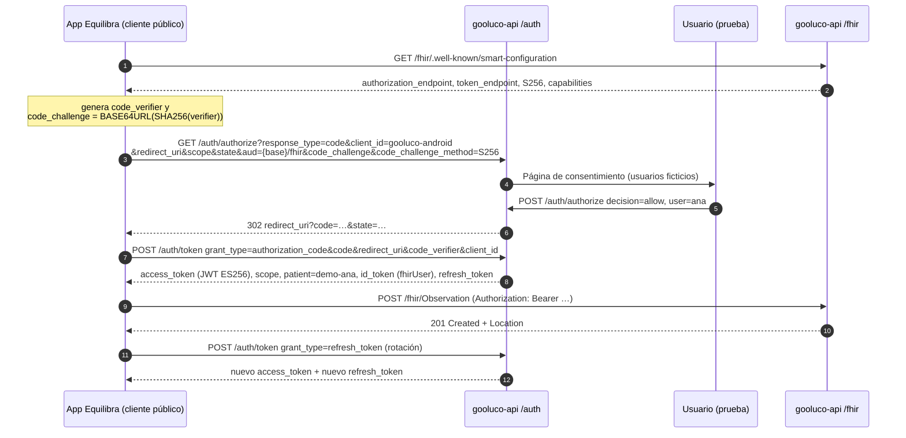
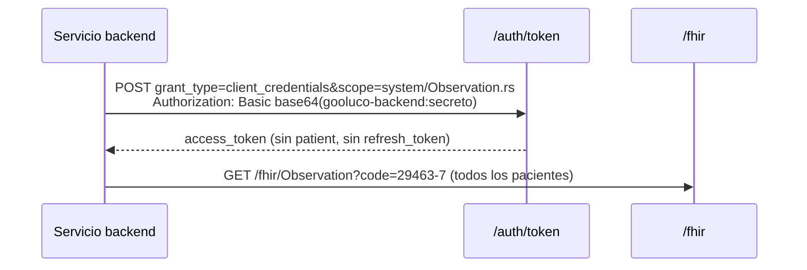

# gooluco-api — FHIR R4 + SMART on FHIR (entorno de prueba)

Backend de **Gooluco / Equilibra** (evaluación del riesgo físico en pacientes con diabetes o prediabetes:
pesajes de la balanza OKOK, IMC calculado = peso / talla², PSS-4 según la agenda diaria, FINDRISC y
Cuestionario Nórdico). Corre en **Cloudflare Workers** (TypeScript + [Hono](https://hono.dev) +
`@hono/zod-openapi`), guarda los datos en **Cloudflare D1** y publica su contrato en **OpenAPI 3.1**.

> ⚠️ **Es un servidor de PRUEBA.** Los usuarios del login son ficticios, no hay contraseñas y los datos
> de semilla son inventados (`Ana Prueba (FICTICIA)`, `Beto Ejemplo (FICTICIO)`). No cargues datos reales
> de pacientes mientras el esquema de autenticación sea el de prueba.

Relación con el SRS v2 (`docs/srs/SRS_v2_OKOK_Riesgo_Diabetes.md`, rama `docs/srs-v2`): implementa la
**exportación/sincronización FHIR (RF-38)** como servicio. La app sigue funcionando sin conexión; esta API
es el destino opcional de la sincronización.

## Contenido

| Ruta | Qué es |
|---|---|
| `src/app.ts` | Ensamblado de la app Hono, middlewares (Content-Type FHIR, Bearer), OpenAPI y `/docs` |
| `src/auth/` | Servidor de autorización OAuth 2.0 / SMART: `/auth/authorize`, `/auth/token`, JWT ES256, scopes v2 |
| `src/fhir/` | Recursos FHIR R4, búsqueda, CapabilityStatement, Questionnaires, almacenamiento D1 |
| `migrations/` | Esquema D1 (`wrangler d1 migrations apply`) |
| `seed/` | Datos de demostración **ficticios** (solo local/pruebas) |
| `test/` | Vitest dentro del runtime de Workers (`@cloudflare/vitest-plugin`, D1 local) |
| `scripts/smoke.sh` | Prueba de humo con `curl` del flujo PKCE completo |

## Endpoints

| Método | Ruta | Auth | Notas |
|---|---|---|---|
| GET | `/fhir/metadata` | pública | `CapabilityStatement` R4 con `rest.security` SMART-on-FHIR |
| GET | `/fhir/.well-known/smart-configuration` (y `/.well-known/smart-configuration`) | pública | Descubrimiento SMART 2.x |
| GET | `/.well-known/openid-configuration`, `/.well-known/jwks.json` | pública | OIDC + clave pública ES256 |
| GET/POST | `/auth/authorize` | — | Página de consentimiento de prueba (usuarios ficticios) |
| POST | `/auth/token` | cliente | `authorization_code` + PKCE, `refresh_token`, `client_credentials` |
| POST | `/auth/introspect` | cliente confidencial | RFC 7662 (diagnóstico) |
| GET | `/fhir/Patient/{id}`, `/fhir/Patient?_id=` | `patient/Patient.rs` · `system/Patient.rs` | |
| POST | `/fhir/Patient` | `system/Patient.c` | Solo backend |
| GET | `/fhir/Observation/{id}` | `…/Observation.r` | |
| GET | `/fhir/Observation?patient=&code=&date=&_count=&_offset=` | `…/Observation.s` | `Bundle` `searchset` |
| POST | `/fhir/Observation` | `…/Observation.c` | Peso, talla, IMC, cintura (LOINC + UCUM) |
| GET/POST | `/fhir/QuestionnaireResponse[/{id}]` `?patient=&questionnaire=&authored=` | `…/QuestionnaireResponse.crs` | PSS-4, FINDRISC, Nórdico |
| GET | `/fhir/Questionnaire[/{id}]` `?url=&name=` | pública | Definiciones (sin datos de pacientes) |
| GET | `/openapi.json` · `/docs` | pública | OpenAPI 3.1 · referencia interactiva (Scalar) |

Errores FHIR: siempre `OperationOutcome` con `Content-Type: application/fhir+json`
(400 validación, 401 sin token / token inválido con `WWW-Authenticate: Bearer …`, 403 scope insuficiente
o fuera del compartimento del paciente, 404, 415 Content-Type, 422 regla de negocio).

### Observaciones soportadas (perfil Vital Signs de FHIR R4)

| Medida | LOINC | UCUM | Perfil |
|---|---|---|---|
| Peso (balanza OKOK) | `29463-7` Body weight | `kg` | `http://hl7.org/fhir/StructureDefinition/bodyweight` |
| Talla | `8302-2` Body height | `cm` | `…/bodyheight` |
| IMC (calculado en la app; la balanza no lo envía) | `39156-5` BMI | `kg/m2` | `…/bmi` |
| Cintura (FINDRISC) | `8280-0` Waist circumference | `cm` | — |

Para las tres primeras se exige `category = observation-category|vital-signs` y `valueQuantity` con
`system = http://unitsofmeasure.org` y el código UCUM de la tabla (p. ej. `[lb_av]` se rechaza: la app
debe convertir a kg). El IMC puede llevar `derivedFrom` apuntando al peso y a la talla.

### Cuestionarios

Canónicos `https://github.com/CravApp/Gooluco/fhir/Questionnaire/{pss4-ema|findrisc|nordico}`.
Los textos y códigos salen de la app (`gooluco-app/.../domain/Pss4.kt`, `Findrisc.kt`, `Nordico.kt`).
El servidor valida que el `questionnaire` exista y que los `linkId` de la respuesta pertenezcan a él.
Los puntajes (PSS-4 0–16 con ítems 2 y 3 invertidos; FINDRISC 0–26, corte Perú ≥ 11) los calcula la app y
viajan en los ítems `pss4-total` / `total`.

## Esquema de autenticación (SMART App Launch 2.x)

### Clientes registrados (estáticos, `src/auth/clients.ts`)

| client_id | Tipo SMART | Grants | Redirect | Scopes máximos |
|---|---|---|---|---|
| `gooluco-android` | `client-public` (app móvil, sin secreto) | `authorization_code` (+ PKCE S256 obligatorio), `refresh_token` | `pe.cravapp.gooluco:/oauth2redirect` y loopback `http://127.0.0.1:*` / `http://localhost:*` (RFC 8252) | `openid fhirUser launch/patient offline_access online_access patient/Patient.rs patient/Observation.crs patient/QuestionnaireResponse.crs` |
| `gooluco-backend` | `client-confidential-symmetric` | `client_credentials` | — | `system/Patient.crs system/Observation.crs system/QuestionnaireResponse.crs` |

Usuarios de prueba en la página de autorización: `ana` → `Patient/demo-ana`, `beto` → `Patient/demo-beto`.

### Flujo authorization_code + PKCE (app Android)



### Flujo client_credentials (backend)



### Qué está implementado y qué está simplificado

| Aspecto | Estado |
|---|---|
| Descubrimiento `.well-known/smart-configuration` con campos obligatorios, `code_challenge_methods_supported: ["S256"]` (sin `plain`) | ✅ |
| `CapabilityStatement.rest.security` con servicio `SMART-on-FHIR` y extensión `oauth-uris` (en SMART 2.x está deprecada; se mantiene por compatibilidad) | ✅ |
| Launch **standalone** de paciente (`launch/patient`, respuesta `patient`) | ✅ |
| PKCE S256 obligatorio, `state` obligatorio, `aud` obligatorio y verificado | ✅ |
| Códigos de un solo uso (120 s), guardados como hash SHA-256 | ✅ |
| Scopes **v2** `(patient\|user\|system)/Tipo.cruds`, negociación por intersección, comodín `*`, compatibilidad v1 `.read/.write` | ✅ |
| Aplicación de scopes por endpoint + compartimento del paciente (`patient/*` solo ve/escribe `Patient/{patient}`) | ✅ |
| `openid fhirUser` → `id_token` ES256 con `fhirUser`; JWKS publicado | ✅ |
| `offline_access` / `online_access` → refresh token con rotación | ✅ (online_access se trata igual que offline_access) |
| Access tokens JWT **ES256** (Web Crypto), `iss`, `aud`=base FHIR, `exp`, `scope`, `patient` | ✅ |
| `client_credentials` | ⚠️ **Simplificado**: secreto compartido (`client_secret_basic`/`client_secret_post`). SMART Backend Services exige `private_key_jwt` (JWT firmado con clave asimétrica RS384/ES384 y JWKS del cliente). |
| Login de usuario | ⚠️ **De prueba**: elegir un usuario ficticio, sin contraseña ni CSRF. Un despliegue real necesita un IdP (contraseña/OTP), consentimiento persistente y protección CSRF. |
| EHR launch (`launch`), `context-ehr-*`, scopes con parámetros (`?category=`), revocación, registro dinámico, `smart-app-state` | ❌ no implementados |
| FHIR: `update`, `delete`, `_history`, `_include`, `_sort`, transacciones/batch | ❌ (solo read, search-type y create) |

### Referencias del estándar usadas

- SMART App Launch 2.2.0 (STU 2.2, basado en FHIR R4):
  - Conformidad, *Capability Sets* («Patient Access for Standalone Apps») y *FHIR Authorization Endpoint and
    Capabilities Discovery using a Well-Known URI*: https://hl7.org/fhir/smart-app-launch/conformance.html
  - Launch and Authorization — *Launch App: Standalone Launch*, *Obtain authorization code* (PKCE S256, `aud`,
    `state`), *Obtain access token*, *Access FHIR API*, *Refresh access token* (scope solo puede reducirse;
    descartar el refresh token anterior): https://hl7.org/fhir/smart-app-launch/app-launch.html
  - Scopes and Launch Context — *Scopes for requesting FHIR Resources* (sufijos `cruds`, equivalencias v1),
    *Patient-specific scopes* (`patient/Observation.rs`, `patient/Observation.c`), *System-level scopes*,
    `launch/patient`, `openid fhirUser`, `offline_access`: https://hl7.org/fhir/smart-app-launch/scopes-and-launch-context.html
  - Backend Services (`client_credentials` + `private_key_jwt`, aquí simplificado):
    https://hl7.org/fhir/smart-app-launch/backend-services.html
  - Client authentication: https://hl7.org/fhir/smart-app-launch/client-confidential-asymmetric.html ·
    https://hl7.org/fhir/smart-app-launch/client-confidential-symmetric.html
- FHIR R4 (4.0.1):
  - RESTful API — *read*, *create* (`201`, `Location`, `ETag`), *search*, *capabilities*, tipo MIME
    `application/fhir+json`: https://hl7.org/fhir/R4/http.html
  - Búsqueda — parámetros `date` (prefijos y precisión implícita), `token` (`system|code`), `reference`, `_count`;
    `Bundle` `searchset`: https://hl7.org/fhir/R4/search.html
  - Perfil Vital Signs (peso 29463-7, talla 8302-2, IMC 39156-5, UCUM): https://hl7.org/fhir/R4/observation-vitalsigns.html
  - `CapabilityStatement`: https://hl7.org/fhir/R4/capabilitystatement.html ·
    `OperationOutcome`: https://hl7.org/fhir/R4/operationoutcome.html ·
    `Questionnaire` / `QuestionnaireResponse`: https://hl7.org/fhir/R4/questionnaire.html ·
    https://hl7.org/fhir/R4/questionnaireresponse.html
- OAuth 2.0 (RFC 6749), PKCE (RFC 7636), apps nativas (RFC 8252), Bearer (RFC 6750), introspección (RFC 7662).

## Puesta en marcha local

Requisitos: Node 20+ (CI usa 22), `jq` y `openssl` para la prueba de humo.

```bash
cd gooluco-api
npm ci
npm run dev:vars          # crea .dev.vars (ignorado por git) con una clave ES256 nueva y el secreto del backend
npm run db:migrate:local  # crea el esquema en el D1 local (.wrangler/)
npm run db:seed:local     # carga los pacientes/observaciones FICTICIOS
npm run dev               # wrangler dev → http://127.0.0.1:8787  (docs en /docs)
```

Pruebas y validaciones (lo mismo que corre CI):

```bash
npm run typecheck
npm test                  # vitest dentro de workerd, con D1 local y clave efímera
npm run openapi:lint      # exporta openapi.json y lo valida con Redocly
BASE=http://127.0.0.1:8787 ./scripts/smoke.sh   # flujo PKCE completo con curl
```

## Ejemplos con curl

```bash
BASE=http://127.0.0.1:8787
REDIRECT=http://127.0.0.1:53682/callback
# PKCE
VERIFIER=$(openssl rand -base64 48 | tr -d '=+/\n' | cut -c1-64)
CHALLENGE=$(printf '%s' "$VERIFIER" | openssl dgst -sha256 -binary | openssl base64 -A | tr '+/' '-_' | tr -d '=')

# 1) Autorizar (en un navegador abrirías esta URL; aquí simulamos el clic "Autorizar" como "ana")
LOC=$(curl -s -o /dev/null -w '%{redirect_url}' -X POST "$BASE/auth/authorize" \
  --data-urlencode response_type=code --data-urlencode client_id=gooluco-android \
  --data-urlencode redirect_uri=$REDIRECT --data-urlencode state=xyz --data-urlencode aud=$BASE/fhir \
  --data-urlencode "scope=launch/patient openid fhirUser offline_access patient/Observation.rs patient/Observation.c" \
  --data-urlencode code_challenge=$CHALLENGE --data-urlencode code_challenge_method=S256 \
  --data-urlencode decision=allow --data-urlencode user=ana)
CODE=$(echo "$LOC" | sed -E 's/.*[?&]code=([^&]+).*/\1/')

# 2) Canjear el código
AT=$(curl -s -X POST $BASE/auth/token -d grant_type=authorization_code -d code=$CODE \
  --data-urlencode redirect_uri=$REDIRECT -d code_verifier=$VERIFIER -d client_id=gooluco-android | jq -r .access_token)

# 3) Registrar un pesaje
curl -s -X POST $BASE/fhir/Observation -H "Authorization: Bearer $AT" -H 'Content-Type: application/fhir+json' -d '{
  "resourceType":"Observation","status":"final",
  "category":[{"coding":[{"system":"http://terminology.hl7.org/CodeSystem/observation-category","code":"vital-signs"}]}],
  "code":{"coding":[{"system":"http://loinc.org","code":"29463-7","display":"Body weight"}]},
  "subject":{"reference":"Patient/demo-ana"},"effectiveDateTime":"2026-11-25T07:05:00-05:00",
  "valueQuantity":{"value":69.8,"unit":"kg","system":"http://unitsofmeasure.org","code":"kg"}}'

# 4) Buscar los pesos de noviembre
curl -s -G $BASE/fhir/Observation -H "Authorization: Bearer $AT" \
  --data-urlencode patient=demo-ana --data-urlencode 'code=http://loinc.org|29463-7' \
  --data-urlencode date=ge2026-11-01 --data-urlencode date=lt2026-12-01 | jq '.total'

# Backend (client_credentials con el secreto de .dev.vars)
SECRET=$(grep BACKEND_CLIENT_SECRET .dev.vars | cut -d"'" -f2)
curl -s -u gooluco-backend:$SECRET -X POST $BASE/auth/token \
  -d grant_type=client_credentials -d 'scope=system/Observation.rs'
```

## Cómo se conectaría la app Android

La app `gooluco-app` (rama `feat/app-base`) hoy es 100 % local y **no declara el permiso `INTERNET`**
(decisión de privacidad del SRS). Para sincronizar con esta API habría que:

1. Agregar `<uses-permission android:name="android.permission.INTERNET"/>` y una opción explícita de
   «Sincronizar con mi centro de salud» (con consentimiento, RF-37), desactivada por defecto.
2. Usar **AppAuth for Android** (`net.openid:appauth`) con Custom Tabs: descubre
   `/fhir/.well-known/smart-configuration`, genera PKCE S256 y recibe el redirect
   `pe.cravapp.gooluco:/oauth2redirect` (registrar el esquema con `manifestPlaceholders["appAuthRedirectScheme"] = "pe.cravapp.gooluco"`).
   Agregar el parámetro adicional `aud={base}/fhir`.
3. Pedir `launch/patient openid fhirUser offline_access patient/Patient.rs patient/Observation.crs patient/QuestionnaireResponse.crs`.
   Guardar el refresh token cifrado (Android Keystore / EncryptedSharedPreferences) y reemplazarlo en cada
   renovación (el servidor rota los refresh tokens).
4. Mapear la base Room a FHIR:
   - `PesajeEntity.pesoKg` → `Observation` 29463-7 (`kg`); `imc` → `Observation` 39156-5 (`kg/m2`) con `derivedFrom`;
     `TallaHistorialEntity` → 8302-2 (`cm`); `PerfilEntity.cinturaCm` → 8280-0 (`cm`).
     **No** enviar la MAC de la balanza ni la trama cruda (`tramaHex`).
   - `EmaRespuestaEntity` → `QuestionnaireResponse` `pss4-ema` (ítems `pss4-1..4`, `pss4-total`, `actividad`, `lugar`, `social`).
   - `FindriscEntity` → `findrisc`; `NordicoEntity` → `nordico` (grupos por región).
5. Subir en segundo plano con WorkManager (restricción de red), con reintentos idempotentes (guardar el `id`
   devuelto en `Location`).
6. Para pruebas contra `wrangler dev` desde el teléfono, exponer el puerto en la LAN
   (`npx wrangler dev --ip 0.0.0.0`) y permitir tráfico HTTP solo en el build debug (`networkSecurityConfig`);
   en producción, solo HTTPS.

## Despliegue en Cloudflare (no realizado)

Nada de esto se ha desplegado. Para hacerlo hace falta una cuenta de Cloudflare:

1. `npx wrangler login` (o un API token con permisos *Workers Scripts:Edit* y *D1:Edit*).
2. `npx wrangler d1 create gooluco-fhir` → copiar el `database_id` en `wrangler.toml` (o en la variable de
   repositorio `D1_DATABASE_ID` para CI).
3. `npx wrangler d1 migrations apply gooluco-fhir --remote` (**no** cargar `seed/` en producción).
4. Secretos: `npm run dev:vars` genera valores; súbelos con
   `npx wrangler secret put JWT_PRIVATE_JWK` y `npx wrangler secret put BACKEND_CLIENT_SECRET`.
5. `npx wrangler deploy`.

CI (`.github/workflows/gooluco-api.yml`): typecheck, tests, lint OpenAPI y `wrangler deploy --dry-run` en cada push a
`feat/**`/`main` y en PRs que tocan `gooluco-api/**`. El job **deploy** es opcional: solo corre en `main` o con
*Run workflow*, y solo si existen los secretos `CLOUDFLARE_API_TOKEN` y `CLOUDFLARE_ACCOUNT_ID` y la variable
`D1_DATABASE_ID`; si faltan, se omite con un aviso.
